# Day 1: From text to the next token

## 1. Why we need it

Your engine from yesterday (`v1-day-00`) computes nothing yet. By the end
of today, `cargo run` takes the text `"hi"`, scores all 256 possible next
tokens, picks the winner, and prints `"j"`. That is the complete skeleton
of an LLM in about 60 lines. Only the weights are fake. Everything
an inference engine will ever do for us is a loop wrapped around three
primitives. That covers serving a chatbot, batching hundreds of requests,
and juggling GPU memory:

- **tensors**: numbers arranged with a shape, multiplied by weight matrices,

- **tokens**: text encoded as integer ids the model can index with,

- **the greedy choice**: turning a row of scores into the single next token.

Today's three sections build one primitive each, and `main` wires them
into a single pipeline. Each section stands alone, with its own runnable
finish and its own checkpoint tag, but together they tell one story. This
whole book keeps telling it: **the running story, for all 15 days, is a
little restaurant, built one scene at a time.**

Today you build its kitchen. Your text is the order slip, and the model is
the cook. Section A builds the recipe board, section B stocks the pantry,
and section C hires the judge.

(On Day 2, the cook starts *learning* from old order tickets.) The whole
story, scene by scene, lives on one page that grows by one scene every
day: [The restaurant: an analogy to help you build the right mental
model](story.md).

## 2. Mental model

Walk the kitchen, one station per section:

- **The pantry (section B's tokenizer).** The kitchen owns exactly 256
  numbered jars, one for every possible byte. So *any* order slip, in any
  language, becomes jar numbers: `"hi"` is jars 104 and 105. No order slip
  can ever ask for an ingredient the pantry lacks.

- **The recipe board (section A's matmul).** A recipe is a column of
  amounts: this much from jar A, this much from jar B. Cooking is
  multiply-and-sum, and one matmul cooks *every recipe on the board at
  once*. Section A's board is `[3, 2]`: three jars in, two recipes out.

  Recipe 1 takes one scoop each from jars A and C, and recipe 2 takes one
  scoop each from jars B and C. Feed it the amounts `[1, 2, 3]`, and you
  get two dish scores (a dish is one token the model could produce next):
  `[4.0, 5.0]` (1 + 3 and 2 + 3). You check this by hand in section A.

- **The judge (section C's greedy pick).** Every candidate dish (every
  token that could come next) gets a score, and those scores are the *logits*. The judge always picks the
  highest. No dice are involved. The same order slip gets the same winner
  every time, on purpose, until correctness is proven (Day 7).

<figure class="book-figure">
  
  <figcaption>Figure 1.1 — One order slip, four steps: encode, matmul, greedy pick, and back to text.</figcaption>
</figure>

## 3. Inference concepts introduced

<div class="dl-concepts"><span>LLM concepts used here:</span>
<a href="https://www.youtube.com/watch?v=wjZofJX0v4M">▶ tokens &amp; logits, visually (3Blue1Brown)</a>
</div>

- **Tensor**: an n-dimensional array plus a *shape* (`[1, 256]`), a *dtype*
  (`f32`), and a *device* (CPU today; GPU first appears on Day 9).

- **Token and vocabulary**: models never see characters. They see integer
  ids drawn from a fixed vocabulary. Ours is the 256 possible bytes.

- **Logits and greedy sampling**: the model's output is one score per
  vocabulary entry (the logits). *Greedy* sampling always picks the
  *argmax*: the id with the highest score. We stay deterministic until correctness is proven (Day 7).
  Temperature sampling arrives with per-request `SamplingParams` on Day 10.

## 4. Build it, section by section

Each section opens with a **Rust used here** strip: the language concepts its
code leans on, linked to the matching pages of Google's
[Comprehensive Rust](https://google.github.io/comprehensive-rust/) course.
Click any of them to read that page in a side panel *beside* this chapter.
You need no prior Rust, and you never leave the page (Esc or × closes it).

### Section A — tensors and one honest matmul

<div class="rust-concepts"><span>Rust used here:</span>
<a href="https://google.github.io/comprehensive-rust/types-and-values/inference.html">type inference &amp; literals</a>
<a href="https://google.github.io/comprehensive-rust/tuples-and-arrays/arrays.html">arrays</a>
<a href="https://google.github.io/comprehensive-rust/references/shared.html">references &amp; borrowing</a>
<a href="https://google.github.io/comprehensive-rust/user-defined-types/enums.html">enums</a>
<a href="https://google.github.io/comprehensive-rust/error-handling/result.html"><code>Result</code></a>
<a href="https://google.github.io/comprehensive-rust/error-handling/try.html">the <code>?</code> operator</a>
<a href="https://google.github.io/comprehensive-rust/testing/unit-tests.html">unit tests (<code>#[test]</code>, <code>#[cfg(test)]</code>)</a>
</div>

Start by adding the tensor library to `Cargo.toml`. We use
[Candle](https://github.com/huggingface/candle), Hugging Face's Rust tensor
library. It runs on CPU and CUDA without dragging the project back to Python:

```toml
[dependencies]
# `=` pins the exact version: every learner builds byte-identical dependencies.
candle-core = "=0.11.0"
```

Now write a warm-up program. Replace `src/main.rs` with:

```rust
# extern crate candle_core;
use candle_core::{Device, Result, Tensor};

fn main() -> Result<()> {
    let device = Device::Cpu;

    // Shape [1, 3]: one row of three features.
    let input = Tensor::new(&[[1_f32, 2.0, 3.0]], &device)?;

    // Shape [3, 2]: turns three input features into two output scores.
    let weights = Tensor::new(&[[1_f32, 0.0], [0_f32, 1.0], [1_f32, 1.0]], &device)?;

    // [1, 3] x [3, 2] -> [1, 2]. The inner dimensions (3) must match.
    let output = input.matmul(&weights)?;

    println!("output shape: {:?}", output.dims());
    println!("{:?}", output.to_vec2::<f32>()?);
    Ok(())
}
```

Four lines are doing all the work here:

- `Tensor::new(&[[1_f32, 2.0, 3.0]], &device)` builds a tensor from a nested
  array. The `1_f32` suffix pins the element type to 32-bit floats, the
  dtype models actually use. Without it, Rust would infer `f64`.

- `input.matmul(&weights)` *borrows* the weights instead of giving them
  away. A real engine reuses the same weights for every request, so lending
  is the only mode that makes sense.

- `Device::Cpu` says where the bytes live. Both tensors must be on the same
  device to be multiplied. That rule starts to matter on Day 9.

- Because `main` returns `Result<()>`, `?` works at the top level. Any
  tensor error stops the program and prints the error. `()` is Rust's empty
  value: on success, `main` has nothing to hand back.

One small mark in the `println!` lines: `{:?}` prints a value in *debug*
form, with brackets and quotes kept. That is how you print shapes, vectors,
and strings throughout this book.

Run `cargo run`. The first run compiles Candle's ~140 crates, so give it a
minute:

```text
output shape: [1, 2]
[[4.0, 5.0]]
```

Check it by hand with the recipe picture. Recipe 1 uses ingredients A and C
(`1·1 + 2·0 + 3·1 = 4`). Recipe 2 uses B and C (`1·0 + 2·1 + 3·1 = 5`). The
machine agrees with your head. Keep the shape rule in your pocket, because
you will use it every day from here on:
`[1, 3] × [3, 2] → [1, 2]` — inner dimensions must match, and they cancel.

Pin both facts, the arithmetic and the shape rule, with two tests at the
bottom of `src/main.rs`:

```rust,ignore
#[cfg(test)]
mod tests {
    use super::*;

    #[test]
    fn tiny_matmul_matches_hand_arithmetic() -> Result<()> {
        let device = Device::Cpu;
        let input = Tensor::new(&[[1_f32, 2.0, 3.0]], &device)?;
        let weights = Tensor::new(&[[1_f32, 0.0], [0_f32, 1.0], [1_f32, 1.0]], &device)?;
        let output = input.matmul(&weights)?;
        assert_eq!(output.dims(), &[1, 2]);
        // Exact float comparison is safe here: every value is a small
        // integer, which f32 represents exactly.
        assert_eq!(output.to_vec2::<f32>()?, vec![vec![4.0, 5.0]]);
        Ok(())
    }

    #[test]
    fn matmul_rejects_mismatched_shapes() {
        let device = Device::Cpu;
        let input = Tensor::new(&[[1_f32, 2.0, 3.0]], &device).unwrap();
        // [1, 3] x [2, 2]: inner dimensions 3 and 2 do not match.
        let bad_weights = Tensor::new(&[[1_f32, 0.0], [0_f32, 1.0]], &device).unwrap();
        assert!(input.matmul(&bad_weights).is_err());
    }
}
```

You may spot two new marks in that code. `#[test]` above a function tells
Rust "this is a test", and `cargo test` finds and runs every function marked
that way. `#[cfg(test)]` above `mod tests` means "compile this module only
when running tests", so the tests never end up inside the program itself.
Lines that start with `#[` are called *attributes*. They are short notes to
the compiler, written right above the thing they describe.

The second test matters as much as the first. Shapes are *values*, checked
at runtime, so the compiler will never catch a shape bug for you. Run
`cargo test`:

```text
running 2 tests
test tests::matmul_rejects_mismatched_shapes ... ok
test tests::tiny_matmul_matches_hand_arithmetic ... ok

test result: ok. 2 passed; 0 failed; 0 ignored; 0 measured; 0 filtered out; finished in 0.00s
```

**Section checkpoint:** `./scripts/compare.sh v1-day-01a` — its ✓ line means
your code matches the official section state. Comments, blank lines, and
item order don't have to match.

### Section B — a byte tokenizer

<div class="rust-concepts"><span>Rust used here:</span>
<a href="https://google.github.io/comprehensive-rust/modules/filesystem.html">modules &amp; source files</a>
<a href="https://google.github.io/comprehensive-rust/references/strings.html"><code>String</code> and <code>&amp;str</code></a>
<a href="https://google.github.io/comprehensive-rust/std-types/vec.html"><code>Vec</code></a>
<a href="https://google.github.io/comprehensive-rust/std-types/option.html"><code>Option</code></a>
<a href="https://google.github.io/comprehensive-rust/iterators/iterator.html">iterators</a>
<a href="https://google.github.io/comprehensive-rust/iterators/collect.html"><code>collect</code></a>
<a href="https://google.github.io/comprehensive-rust/error-handling/panics.html">panics &amp; <code>expect</code></a>
</div>

Your matmul works on numbers, but users send text. The bridge between them
is the tokenizer, the story's pantry. The simplest honest one is
*byte-level*: every UTF-8 byte is one numbered jar. The vocabulary has
exactly 256 entries, and nothing is ever out-of-vocabulary. (Real
tokenizers merge frequent byte pairs into bigger tokens. That efficiency
upgrade arrives with the real model on Day 7.)

Create `src/tokenizer.rs`:

```rust
# fn main() {}
/// Analogy: the pantry — 256 numbered jars, one per possible byte.
///
/// Text is UTF-8 bytes, so the vocabulary is fixed at 256 and no input can
/// ever be out-of-vocabulary.
pub const VOCAB_SIZE: usize = 256;

/// Text -> token ids, one id per UTF-8 byte.
pub fn encode(text: &str) -> Vec<u32> {
    text.bytes().map(u32::from).collect()
}

/// Token ids -> text. Returns None if an id is not a byte (> 255) or the
/// bytes are not valid UTF-8 (e.g. a lone continuation byte).
pub fn decode(ids: &[u32]) -> Option<String> {
    let bytes = ids
        .iter()
        .map(|&id| u8::try_from(id).ok())
        .collect::<Option<Vec<u8>>>()?;
    String::from_utf8(bytes).ok()
}
```

Notice three things here:

- `encode` cannot fail, because every string *is* bytes. It is a pure
  iterator chain, with no loop counter to get wrong.

- `decode` can fail in two ways: an id over 255, or bytes that are not
  valid UTF-8. (A character like `é` spans several bytes. The bytes after
  the first are *continuation bytes*, and one on its own is not text.) So
  it returns `Option<String>`. The
  `collect::<Option<Vec<u8>>>()` trick gathers per-item `Option`s into one,
  and a single `None` poisons the whole collection. The `?` after it works
  on `Option` the same way it works on `Result`.

- `|&id| u8::try_from(id).ok()` is a *closure*: a small unnamed function
  that `map` calls once per item. `|&id|` names its argument, and the `&`
  unwraps the reference the iterator hands out. `try_from` returns a
  `Result`, and `.ok()` turns it into an `Option`: `Ok(byte)` becomes
  `Some(byte)`, and any error becomes `None`.

- Encoding is about *bytes*, not characters. `"héllo"` is 5 characters but
  **6** tokens, because `é` is two bytes in UTF-8.

Now introduce the new module to the rest of the crate, with two small
additions to `src/main.rs`.

**First**, add one line near the top, right under the `use` line. It is
the first cut in what will eventually become `model/`, `engine/`, and
`scheduler/` modules:

```rust,ignore
mod tokenizer;
```

**Second**, add a few demo lines inside `main`, just before `Ok(())`:

```rust,ignore
    let text = "hi";
    let ids = tokenizer::encode(text);
    println!(
        "vocab size {} -> text {text:?} -> token ids {ids:?}",
        tokenizer::VOCAB_SIZE
    );
    let back = tokenizer::decode(&ids).expect("ids from valid text always decode");
    println!("decoded back: {back:?}");
```

`expect` is the emergency exit on `Option` and `Result`: take the value, or
*crash now* with this message. Here the crash genuinely cannot happen,
because the ids came from `encode` one line earlier. The message documents
that reasoning.

`cargo run` now shows encode, then decode, after the warm-up matmul:

```text
output shape: [1, 2]
[[4.0, 5.0]]
vocab size 256 -> text "hi" -> token ids [104, 105]
decoded back: "hi"
```

Read it line by line, against the code you just wrote:

- `output shape: [1, 2]` and `[[4.0, 5.0]]` — section A's warm-up matmul
  is still there, untouched.

- `vocab size 256 -> text "hi" -> token ids [104, 105]` — this comes from
  the demo lines you just added. `VOCAB_SIZE` is the pantry's jar count, and
  `encode` turned each letter into its jar number: `h` is byte 104, `i` is
  105.

- `decoded back: "hi"` — `decode` reassembled those bytes into text.
  Encode, then decode, gives back the same text, and the tests below pin
  exactly that.

Now pin the behavior with four tests at the bottom of `src/tokenizer.rs`.
They cover both encode-then-decode checks and both `decode -> None`
failure modes:

```rust,ignore
#[cfg(test)]
mod tests {
    use super::*;

    #[test]
    fn decode_undoes_encode_ascii() {
        let ids = encode("hello");
        assert_eq!(ids, vec![104, 101, 108, 108, 111]);
        assert_eq!(decode(&ids), Some("hello".to_string()));
    }

    #[test]
    fn multibyte_text_uses_more_tokens_than_chars() {
        // é is two bytes in UTF-8, so 5 characters become 6 tokens.
        let ids = encode("héllo");
        assert_eq!(ids.len(), 6);
        assert_eq!(decode(&ids), Some("héllo".to_string()));
    }

    #[test]
    fn decode_rejects_ids_larger_than_a_byte() {
        assert_eq!(decode(&[104, 999]), None);
    }

    #[test]
    fn decode_rejects_invalid_utf8() {
        // 0xF0 opens a 4-byte sequence; 0x28 is not a valid continuation.
        assert_eq!(decode(&[0xF0, 0x28]), None);
    }
}
```

Then run only this module's tests:

```bash
cargo test tokenizer
```

```text
running 4 tests
test tokenizer::tests::multibyte_text_uses_more_tokens_than_chars ... ok
test tokenizer::tests::decode_rejects_invalid_utf8 ... ok
test tokenizer::tests::decode_undoes_encode_ascii ... ok
test tokenizer::tests::decode_rejects_ids_larger_than_a_byte ... ok

test result: ok. 4 passed; 0 failed; 0 ignored; 0 measured; 2 filtered out; finished in 0.00s
```

(`2 filtered out` counts section A's tests. The filter `tokenizer` skipped them.)

**Section checkpoint:** `./scripts/compare.sh v1-day-01b`

### Section C — logits and the greedy choice

<div class="rust-concepts"><span>Rust used here:</span>
<a href="https://google.github.io/comprehensive-rust/types-and-values/variables.html">variables &amp; <code>mut</code></a>
<a href="https://google.github.io/comprehensive-rust/control-flow-basics/loops/for.html"><code>for</code> loops &amp; ranges</a>
<a href="https://google.github.io/comprehensive-rust/iterators/helpers.html">iterator helpers (<code>enumerate</code>)</a>
<a href="https://google.github.io/comprehensive-rust/references/slices.html">slices</a>
<a href="https://google.github.io/comprehensive-rust/std-traits/casting.html">casting with <code>as</code></a>
</div>

<div class="dl-concepts"><span>LLM concepts used here:</span>
<a href="https://www.youtube.com/watch?v=wjZofJX0v4M">▶ tokens &amp; logits, visually (3Blue1Brown)</a>
</div>

You have a matmul and a pantry. Now for the satisfying part: wiring A and
B together. You will turn the last token id into a tensor, score every
possible next token with one matmul, and pick the winner. Three small
functions go into `src/main.rs`, above `fn main`, around line 5, right
under `mod tokenizer;`. Here are the first two:

```rust
# extern crate candle_core;
# use candle_core::{Device, Result, Tensor};
# mod tokenizer { pub const VOCAB_SIZE: usize = 256; }
/// A deterministic toy "model": after byte b it scores byte b+1 highest.
/// Real, learned weights arrive on Day 2 — today the point is the pipeline.
fn next_byte_weights(device: &Device) -> Result<Tensor> {
    let mut w = vec![0_f32; tokenizer::VOCAB_SIZE * tokenizer::VOCAB_SIZE];
    for b in 0..tokenizer::VOCAB_SIZE {
        w[b * tokenizer::VOCAB_SIZE + (b + 1) % tokenizer::VOCAB_SIZE] = 1.0;
    }
    Tensor::from_vec(w, (tokenizer::VOCAB_SIZE, tokenizer::VOCAB_SIZE), device)
}

/// One-hot row for a token id: shape [1, VOCAB_SIZE], all zeros except id.
fn one_hot(id: u32, device: &Device) -> Result<Tensor> {
    let mut row = vec![0_f32; tokenizer::VOCAB_SIZE];
    row[id as usize] = 1.0;
    Tensor::from_vec(row, (1, tokenizer::VOCAB_SIZE), device)
}
```

- The weight matrix has one row per *current* byte and one column per
  *candidate next* byte. Row `b` holds a single `1.0` in column `b + 1`
  (wrapping at 255). It is a made-up model, and honestly labeled as such.

- `w` is that 256 × 256 matrix stored as one flat `Vec`, row after row,
  which is the form `Tensor::from_vec` takes. Row `b` starts at index
  `b × 256`, so `w[b * VOCAB_SIZE + c]` is row `b`, column `c`. Here
  `c = (b + 1) % VOCAB_SIZE`, and the `%` (remainder) wraps 256 back to 0.

- A *one-hot* row is the simplest possible encoding of "which one?". It
  holds 256 zeros with a single 1 at position `id`. Picture a strip of 256
  light switches with exactly one flipped on (the "hot" one). When you
  multiply it against a matrix, it copies out row `id` and zeroes
  everything else. So `[1, 256] × [256, 256]` selects one row using nothing
  but multiplication. (On Day 3 a real embedding lookup replaces this trick.)

Greedy sampling, the story's judge, is deliberately plain Rust. That way you
can see there is no magic in "the model chose a token": it is `argmax`. It
goes right below `one_hot`:

```rust
# extern crate candle_core;
# use candle_core::{Result, Tensor};
/// Analogy: the judge.
///
/// Greedy sampling: pick the highest-scoring token id (ties -> lowest id).
fn greedy_pick(logits: &Tensor) -> Result<u32> {
    let rows = logits.to_vec2::<f32>()?;
    let row = &rows[0];
    let mut best = 0;
    for (id, score) in row.iter().enumerate() {
        if *score > row[best] {
            best = id;
        }
    }
    Ok(best as u32)
}
```

Ties break toward the lowest id (`>` not `>=`). The rule is arbitrary, but
it is *fixed*. Determinism is a feature we defend with a test. The `*` in
`*score` reads the number behind a reference (`iter()` hands out
references, not copies). You'll see the same `*` in `main` below, on
`*ids.last()`.

Finally, replace `main` with the pipeline. The warm-up matmul and the
encode-then-decode demo leave `main`. You don't lose them: the tests from sections
A and B already pin their behavior, and those tests stay exactly where they
are:

```rust
# extern crate candle_core;
# use candle_core::{Device, Result, Tensor};
# mod tokenizer {
#     pub const VOCAB_SIZE: usize = 256;
#     pub fn encode(text: &str) -> Vec<u32> {
#         text.bytes().map(u32::from).collect()
#     }
#     pub fn decode(ids: &[u32]) -> Option<String> {
#         let bytes = ids
#             .iter()
#             .map(|&id| u8::try_from(id).ok())
#             .collect::<Option<Vec<u8>>>()?;
#         String::from_utf8(bytes).ok()
#     }
# }
# fn next_byte_weights(device: &Device) -> Result<Tensor> {
#     let mut w = vec![0_f32; tokenizer::VOCAB_SIZE * tokenizer::VOCAB_SIZE];
#     for b in 0..tokenizer::VOCAB_SIZE {
#         w[b * tokenizer::VOCAB_SIZE + (b + 1) % tokenizer::VOCAB_SIZE] = 1.0;
#     }
#     Tensor::from_vec(w, (tokenizer::VOCAB_SIZE, tokenizer::VOCAB_SIZE), device)
# }
# fn one_hot(id: u32, device: &Device) -> Result<Tensor> {
#     let mut row = vec![0_f32; tokenizer::VOCAB_SIZE];
#     row[id as usize] = 1.0;
#     Tensor::from_vec(row, (1, tokenizer::VOCAB_SIZE), device)
# }
# fn greedy_pick(logits: &Tensor) -> Result<u32> {
#     let rows = logits.to_vec2::<f32>()?;
#     let row = &rows[0];
#     let mut best = 0;
#     for (id, score) in row.iter().enumerate() {
#         if *score > row[best] {
#             best = id;
#         }
#     }
#     Ok(best as u32)
# }
fn main() -> Result<()> {
    let device = Device::Cpu;

    let text = "hi";
    let ids = tokenizer::encode(text);
    println!("text {text:?} -> token ids {ids:?}");

    let last = *ids.last().expect("prompt must not be empty");
    let input = one_hot(last, &device)?; // [1, 256]
    let weights = next_byte_weights(&device)?; // [256, 256]
    let logits = input.matmul(&weights)?; // [1, 256]: the inner 256s cancel
    println!("logits shape: {:?}", logits.dims());

    let next = greedy_pick(&logits)?;
    let piece = tokenizer::decode(&[next]).expect("next byte is not decodable on its own");
    println!("greedy next token: {next} -> {piece:?}");
    Ok(())
}
```

Here are the shapes through the whole pipeline. Make these shapes a reflex:

<figure class="book-figure">
  
  <figcaption>Figure 1.2 — The shapes through the whole pipeline. In the matmul the inner 256s cancel, leaving one row of 256 scores.</figcaption>
</figure>

Pin the new behavior with two more tests. They go inside the
`#[cfg(test)] mod tests` block at the bottom of `src/main.rs`, below
section A's tests:

```rust,ignore
#[cfg(test)]
mod tests {
    ⋮
    ⋮
    // ──────── new code starts here (around line 56) ────────
    #[test]
    fn toy_model_predicts_the_next_ascii_byte() -> Result<()> {
        let device = Device::Cpu;
        let logits = one_hot(104, &device)?.matmul(&next_byte_weights(&device)?)?;
        assert_eq!(greedy_pick(&logits)?, 105); // 'h' -> 'i'
        Ok(())
    }

    #[test]
    fn greedy_pick_breaks_ties_toward_the_lowest_id() -> Result<()> {
        let device = Device::Cpu;
        let flat = Tensor::zeros((1, tokenizer::VOCAB_SIZE), candle_core::DType::F32, &device)?;
        assert_eq!(greedy_pick(&flat)?, 0);
        Ok(())
    }
    // ──────── new code ends here ────────
}
```

The first test drives the exact matmul that `main` runs, and it demands
byte 105 after byte 104. The tie-break test feeds *all-equal* logits and
demands id 0. It pins the determinism rule, not only the happy path.

**Section checkpoint:** `./scripts/compare.sh v1-day-01c`. It is identical
to `v1-day-01`, because the last section of a day *is* the day.

## 5. Run it

```bash
cargo run
```

## 6. Expected result

```text
text "hi" -> token ids [104, 105]
logits shape: [1, 256]
greedy next token: 106 -> "j"
```

Trace it by hand. `h` is byte 104, and `i` is byte 105. After 105, the toy
weights score byte 106 highest, and byte 106 is `"j"`. Run it five times,
and you get the same answer five times. Greedy picking is deterministic,
and it stays that way until the engine has a correctness oracle (Day 7).

## 7. Test it

Eight tests now pin today's behavior. Section A covers the warm-up matmul
and its shape-mismatch rejection. Section B covers the tokenizer's
encode-then-decode checks and both failure modes. Section C covers the toy model and the
tie-break rule. Run the whole suite:

```bash
cargo test
```

```text
running 8 tests
test tokenizer::tests::decode_rejects_invalid_utf8 ... ok
test tests::greedy_pick_breaks_ties_toward_the_lowest_id ... ok
test tokenizer::tests::decode_rejects_ids_larger_than_a_byte ... ok
test tests::matmul_rejects_mismatched_shapes ... ok
test tokenizer::tests::multibyte_text_uses_more_tokens_than_chars ... ok
test tokenizer::tests::decode_undoes_encode_ascii ... ok
test tests::tiny_matmul_matches_hand_arithmetic ... ok
test tests::toy_model_predicts_the_next_ascii_byte ... ok

test result: ok. 8 passed; 0 failed; 0 ignored; 0 measured; 0 filtered out; finished in 0.00s
```

## 8. Break it deliberately

Send the engine an empty prompt:

```diff
-    let text = "hi";
+    let text = "";
```

`cargo run` now prints (your line number may differ):

```text
thread 'main' panicked at src/main.rs:42:28:
prompt must not be empty
note: run with `RUST_BACKTRACE=1` environment variable to display a backtrace
```

Compare the two failure styles you have now seen. A shape mismatch travels
through `Result` and `?`. It is a *recoverable* error handed to the caller,
and the `matmul_rejects_mismatched_shapes` test pins it. The empty prompt
hits `expect`, which *panics*: an unconditional crash with a named reason.
Panicking is the right tool only while the caller is you. Once requests
come from strangers (the HTTP server on Day 15), "prompt must not be empty"
must become a polite `400 Bad Request` instead of a dead process. Where to
draw the validation boundary is a real engineering decision, and you have
already met it on Day 1.

Restore `"hi"` and confirm `cargo test` is green again.

## 9. Checkpoint

Every checkpoint — each section and the day — is done only when the full
green bar passes:

```bash
./scripts/check.sh
```

<details>
<summary>Optional: why the check script stages libraries</summary>

`mdbook test` compiles this book's code blocks against your built
dependencies. Clippy leaves extra `.rmeta` metadata files next to the
`.rlib` libraries, and rustdoc refuses to choose between them (error
E0464). So the check script has copied clean libraries into
`target/doctest-libs` since Day 0.

Today is the first day that matters, because `candle-core` is your first
dependency. The script is a few commented lines, and nothing else is
hidden in it.

</details>

Then close out the day in whichever mode you are following:

**Built along on your own branch?** Confirm that your code matches the
finished day. The final ✓ line means it does:

```bash
./scripts/compare.sh v1-day-01
```

**Inspecting instead of typing?** Jump to today's exact finished state,
explore it, and come back:

```bash
git switch --detach v1-day-01
cargo test
git switch -          # back to where you were
```

**Either way**, you can read today's complete change set, docs included,
as one diff:

```bash
git diff v1-day-00 v1-day-01
```

## 10. Recap

**What changed today:** your project gained a tensor library (pinned
`candle-core =0.11.0`) and a byte tokenizer module whose `decode` gives
back exactly the text `encode` was given. It also gained a toy next-byte
model, plain-Rust greedy sampling, and a `main` that runs the full
pipeline: text, ids, logits, choice, and back to text.

Eight tests pin all of it across three section checkpoints (`v1-day-01a`,
`v1-day-01b`, `v1-day-01c`).

**Deliberately naive:** the weights are hard-coded, not learned. The
one-hot matmul is a row lookup in disguise. The model uses only the *last*
token, so it has no context. We generate exactly one token, not a sequence.
And decoding a single byte at a time would garble multi-byte UTF-8: `"é"`
can never be produced one token per call.

**Tomorrow's limitation, resolved on Day 2:** one predicted byte is not
language, and today's cook works from a hard-coded rulebook. On Day 2 the
cook finally *learns*. You will build a bigram model whose weights come
from counting real text. It serves whole sequences through an
autoregressive loop that feeds each output back in. You ship it as a
`generate` CLI with tests: your first end-to-end language model.
