# Day 4: Causal attention

## 1. Why we need it

**The story so far** — remember [the restaurant](story.md): Day 1 built
the kitchen, and Day 2 taught the cook to serve each course from the last
one. Yesterday the dining room opened. Every [guest](story.md#guest) (one
per token of your prompt) traded their numbered badge for a [profile
card](story.md#embedding).

Then every card had its [volume](story.md#rmsnorm) leveled, its [numbers
re-mixed](story.md#linear), and its [seat number](story.md#rope) stamped
on. Then the chapter ended, and the room went quiet. Tonight comes the
scene the whole restaurant has been building toward: **the table
conversation**. The guests finally talk.

Each one reads the cards of the guests seated before them and borrows what
they need. That conversation is *attention*, and building it is today's
whole task.

Why does the restaurant need a conversation at all? Look at what your
engine can do so far. The `generate` loop still chooses every course from
the *previous byte alone*. Ask it to continue `"the cat sat on the"`, and
all it knows is the final letter, that `"e"`. The cat, the sitting, and
the whole sentence of setup are invisible to it. Day 3, for all its work,
did not change that. Every profile card was written, leveled, and stamped
*in isolation*, so a guest's card still says nothing about any other guest
at the table.

The conversation is the missing move. It is the moment one guest's card
finally reaches another's, and it is how the model will connect an `"it"`
back to `"the cat"` from twenty words earlier. You build the conversation
in two sections:

- **A. The rules of the conversation** are three small functions, one
  rule each, plus a fourth that runs them in order. *Scoring* asks how relevant one guest is to another right
  now, with one number per pair of guests. *Etiquette* says nobody may
  listen to a guest who hasn't spoken yet, so every score pointing at the
  future is silenced (the **causal mask**). *Sharing out* gives each guest
  exactly 100% of attention to spend, and **softmax** turns the surviving
  scores into that split.

- **B. The conversation at full scale** upgrades the same rules twice.
  Every guest listens through several narrow ears at once, and each ear is
  tuned to its own kind of connection (**heads**). Because memory is
  limited, groups of ears also share their topic cards and statements
  (**grouped-query attention**, GQA).

Along the way, a new `cargo run -- attention` demo prints the
conversation mid-flight, one grid per rule: the raw match scores, the
same grid with the future silenced, and the who-listens-to-whom shares.

<div class="dl-concepts"><span>LLM concepts used here:</span>
<a href="https://www.youtube.com/watch?v=eMlx5fFNoYc">▶ Attention, step by step (3Blue1Brown)</a>
<a href="https://www.youtube.com/watch?v=kCc8FmEb1nY">▶ Let's build GPT — attention from scratch (Karpathy)</a>
<a href="https://www.deeplearning.ai/short-courses/how-transformer-llms-work/">full course: How Transformer LLMs Work (DeepLearning.AI) ↗</a>
</div>

## 2. Mental model

<div class="callout">

**Reading tip:** this section and the "Inference concepts" section after
it are the day's densest reading: all ideas, no code. If they start to
blur, that is normal, and nothing is lost. Jump ahead to section 4 and
*build* the thing, then come back. The ideas are far easier to hold once
you have watched the demo print them.

</div>

First meet the ideas one at a time. Then you follow one guest through all
of them with numbers.

- **Three things from one card.** Before talking, each guest makes three
  new things from their profile card. The **question** (`q`) asks: what am
  I looking for right now? The **topic card** (`k`) answers: what can I be
  asked about? The **statement** (`v`) holds what I will actually
  contribute if someone listens to me.

  All three are made the Day 3 way, with a translator (`Linear`) that
  re-mixes the card's numbers. Why make a question, a topic card and a
  statement separately? What you *seek*, what you can be *found by*, and
  what you *say* are different roles. One card could never play all three
  at once.

- **Match questions to topic cards.** Guest *i* holds their question up
  against guest *j*'s topic card. The better the match (a *dot product*:
  multiply the numbers in matching positions and add them up), the higher
  the score. Long cards inflate scores by sheer arithmetic, because the sum
  has more numbers in it. So every score is divided by the square root of
  the card length to keep things fair. (Why the root? Products of mixed
  signs partly cancel, so a sum of *n* of them typically grows like √*n*,
  not *n*.)

- **Etiquette: only listen to guests who have spoken.** During generation
  the engine produces one token at a time. At the moment guest *i* speaks,
  guests *i+1, i+2, …* haven't arrived yet. When the engine reads a whole
  prompt at once, though, the later guests *are* already at the table. So
  the mask hides them: every score pointing at a later seat is set to
  negative infinity. The whole-prompt pass then knows no more than
  generation could.

- **Split your attention into shares.** Every guest has exactly 100% of
  attention to distribute, so raw scores must become shares that sum to 1.
  The obvious way is to divide each score by the row's total, and it
  breaks immediately. Scores can be negative, and a negative share of
  attention means nothing. The masked `-inf` must also come out as
  *exactly* no attention. So **softmax** exponentiates first. `exp` makes
  every score positive and sends `-inf` to exactly 0. It also stretches
  the gaps, so a clearly better match earns a clearly bigger share. *Then*
  softmax divides by the row's total. A huge score takes most of the
  attention, and the guest walks away with the share-weighted blend of the
  statements they listened to.

- **Several conversations at once.** One blend per guest is crude. "The
  cat sat on *it*" needs one ear on grammar and another on which thing
  "it" was. So the card is split among several **heads**. Each head is a
  narrow ear that runs the identical routine on its own slice, listening
  for its own kind of connection.

- **Share the topic cards — memory is limited.** Questions are cheap to
  hold: each guest asks once, on arrival, and later guests ask their own.
  Topic cards and statements, though, must stay in memory for every
  *future* guest to consult. So groups of ears share one
  topic-card/statement pair: here, 4 askers share 2 pairs.

  That is **grouped-query attention (GQA)**. The shared pairs are exactly
  what Day 8 will cache (the KV cache, which the story calls the
  mise-en-place shelf), so halving them now halves that cache forever. It
  is a rare treat: an architecture choice made *for the inference
  engineer*.

- **The seat stamp moves inside.** Day 3's demo stamped seats (RoPE) onto
  whole cards. From today the stamp goes only on the *question* and the
  *topic card*, inside attention. The statement is never stamped, and
  neither is the **prepped card**: a guest's profile card after Day 3's
  volume knob (`RmsNorm`), the input to the conversation.

  Where you sit should decide *whom you listen to* (the dials make nearby
  guests match louder), not *what you say* once heard.

### Follow one guest through a conversation

Now walk one conversation end to end, first for **one guest**, then for the
whole table. Follow guest 2, the last of three guests. Its prepped card
is one row of 8 numbers, `[1, 8]` (1 guest × 8 numbers). The conversation has
six short stages, and each one shows its inputs before any arithmetic.

The numbers are made up and rounded, so you can check them in your head.
The walk also skips two small adjustments: the seat stamp (RoPE) and the
division by the square root of the card length. Section A builds both.
They nudge the numbers without changing the flow.

**Stage 1: one card becomes a question, a topic card and a statement.** Three translators read guest
2's card:

<figure class="book-figure">
  
  <figcaption>Figure 4.1 — Stage 1: one [1, 8] card becomes an 8-number question, a 4-number topic card and a 4-number statement.</figcaption>
</figure>

The question is 8 numbers: 4 ears × 2. The topic card and statement are
only 4 numbers: 2 shared pairs × 2, because pairs of ears share them. Each
gap between groups of cells marks where one slice ends.

**Stage 2: cut into ears.** This stage is bookkeeping and computes
nothing. Ear 0 takes question slice 0. Ears 0 and 1 share pair 0 of the
topic card and statement:

<figure class="book-figure">
  
  <figcaption>Figure 4.2 — Stage 2: ear 0's slices of guest 2's question, topic card and statement.</figcaption>
</figure>

**Stage 3: collect everyone's topic cards and statements.** Ear 0 is about to meet the other
guests, so first list what they bring. Every guest ran stages 1 and 2 on
its own card. Here are all three guests' ear-0 question and pair-0 topic
card and statement:

| Guest | Question (ear 0) | Topic card (pair 0) | Statement (pair 0) |
|-------|------------------|---------------------|--------------------|
| 0 | `[1, 0]` | `[1, 0]` | `[10, 0]` |
| 1 | `[0, 1]` | `[0, 1]` | `[0, 10]` |
| 2 | `[1, 1]` | `[1, 1]` | `[5, 5]` |

Guest 2 uses only its own question, together with *everyone's* topic cards
and statements. The other two questions come back in the whole-table view
below.

**Stage 4: score, mask, share.** This stage and the next are where guest
2 meets the others. A score is a dot product: multiply the numbers in
matching positions and add them up. Then softmax turns the scores into
shares. `exp(1)` is 2.72 and `exp(2)` is 7.39:

<figure class="book-figure">
  
  <figcaption>Figure 4.3 — Stage 4: three dot products become scores, and softmax turns them into shares that sum to 1.</figcaption>
</figure>

**Stage 5: blend the statements.** Each guest's pair-0 statement is
weighted by its share, and the weighted statements are added:

<figure class="book-figure">
  
  <figcaption>Figure 4.4 — Stage 5: the share-weighted statements add up to what ear 0 heard.</figcaption>
</figure>

**Stage 6: the other ears, then stitch.** Ear 1 repeats stages 4 and 5
with its own question slice, `[0.4, -0.2]`, against the same pair-0 cards.
Its scores are `[0.4, -0.2, 0.2]`, its shares `[0.42, 0.23, 0.35]`, and it
hears `[5.95, 4.05]`. Ears 2 and 3 use pair 1 the same way. The walk
leaves their numbers out, shown as `·`:

<figure class="book-figure">
  
  <figcaption>Figure 4.5 — Stage 6: stitch the four ears, then re-mix with o into a new card of the same shape.</figcaption>
</figure>

Only stages 3 to 5 involve anyone else. Before and after them, guest 2
works on its own card:

| Stage | What it uses | Guests touched |
|-------|--------------|----------------|
| 1–2 translate, cut into ears | your own card | only you |
| 3–4 collect, match → shares | **your** question × **everyone's** topic cards | you + earlier guests |
| 5 blend | **your** shares × **everyone's** statements | you + earlier guests |
| 6 stitch, re-mix | your own 4 ears' results | only you |

Now zoom out to the whole table at once. All three guests run stages 1, 2
and 6 side by side, as the three rows of one grid. Stage 4 needs every
guest's topic card together, so each ear's shares come out as a `[3, 3]`
grid, one row per guest. Guest 2's row is the `[0.21, 0.21, 0.58]` you
just computed.

Guest 1's question `[0, 1]` scores 0 against guest 0's topic card and 1
against its own, and guest 2 is masked as the future. So its shares are
`exp(0)` and `exp(1)` (1 and 2.72) divided by their total of 3.72. Guest 0
can hear only itself. Here is ear 0:

<figure class="book-figure">
  
  <figcaption>Figure 4.6 — Ear 0's shares for the whole table: each row sums to 1, and the future gets exactly 0.</figcaption>
</figure>

Each conversation makes four such grids, one per ear. Here is the
conversation in shapes:

<figure class="book-figure">
  
  <figcaption>Figure 4.7 — The conversation in shapes: [3, 8] in, [3, 8] out, with k and v at half width.</figcaption>
</figure>

The reading rule is the same as yesterday: every shape is `[how many
guests, how many numbers each]`. Tomorrow covers what each guest *does*
with what they carried away, and how the whole round gets packaged into
one repeatable unit. Day 5 builds the digestion step and the decoder
block.

## 3. Inference concepts introduced

<div class="dl-concepts"><span>LLM concepts used here:</span>
<a href="https://www.youtube.com/watch?v=eMlx5fFNoYc">▶ attention, visually (3Blue1Brown)</a>
<a href="https://nn.labml.ai/transformers/mha.html">multi-head attention, formally (labml)</a>
<a href="https://arxiv.org/abs/2305.13245">the GQA paper ↗</a>
</div>

- **Causality is an inference contract, not a math nicety.** The engine
  generates left to right, appending one token at a time. The future
  provably cannot reach back, so everything computed for old tokens stays
  valid as new ones arrive. That is why the engine can compute it *once*
  and cache it. If you break the mask, no cache is ever safe. Day 8 stands
  entirely on today's `the_future_cannot_reach_back` test.

- **GQA is why real models are servable.** At serving time, the engine
  must keep the topic cards (k) and statements (v) of every past token
  (the KV cache, Day 8). Qwen3-0.6B, the model you load on Day 6, has 16
  query heads but only 8 kv heads (its config file lists
  `num_attention_heads: 16` and `num_key_value_heads: 8`, and Day 6 prints
  both).

  Keeping 8 kv heads instead of 16 halves that memory *for the life of
  every request*. Qwen, Llama, and friends all ship GQA for exactly this
  reason.

- **Softmax turns scores into a budget.** Shares that always sum to 1 make
  attention a weighted *average*. Outputs stay in a sane range no matter
  how wild the scores get. And the mask's `-inf` becomes exactly 0 share,
  not merely a small one.

## 4. Build it, section by section

Today you add one new file, `src/attention.rs`, which holds the
conversation. It leans on yesterday's `layers.rs` for `Linear` and `rope`.

### Section A — attention scores, the causal mask, softmax

<div class="rust-concepts"><span>Rust used here:</span>
<a href="https://google.github.io/comprehensive-rust/closures.html">closures (and <code>move</code>)</a>
<a href="https://google.github.io/comprehensive-rust/iterators/iterator.html">iterator chains (<code>flat_map</code>)</a>
</div>

<div class="dl-concepts"><span>LLM concepts used here:</span>
<a href="https://www.youtube.com/watch?v=eMlx5fFNoYc">▶ attention, step by step (3Blue1Brown)</a>
<a href="https://www.youtube.com/watch?v=kCc8FmEb1nY">▶ the same code, in Python (Karpathy)</a>
</div>

In section A you write the rules of the conversation as four small
functions. The first three match questions to topic cards, silence the
future, and split attention into shares. The fourth composes them into a
full conversation. Start a new file, `src/attention.rs`, with all four:

*(These are today's core ideas, ~45 lines. Typing them out builds
finger-memory, but copying them straight from here is just as legitimate.
Every function body is four lines or less.)*

```rust
# extern crate candle_core;
# fn main() {}
use candle_core::{D, Result, Tensor};

/// Analogy: how well one guest's question matches another's topic card —
/// every question dotted against every topic card, in one matmul.
///
/// scores[i][j] = q_i . k_j / sqrt(head_dim). Longer cards make raw dot
/// products bigger by pure arithmetic (more terms in the sum), so dividing
/// by sqrt(len) keeps scores comparable whatever the card size.
pub fn scaled_scores(q: &Tensor, k: &Tensor) -> Result<Tensor> {
    let (_seq, head_dim) = q.dims2()?;
    q.matmul(&k.t()?)? * (1.0 / (head_dim as f64).sqrt())
}

/// Analogy: table etiquette — a guest may listen only to guests seated
/// before them, who have already spoken; later seats have not.
///
/// Every score in a seat's future becomes -inf, which softmax will turn
/// into a share of exactly zero.
pub fn mask_future(scores: &Tensor) -> Result<Tensor> {
    let (rows, cols) = scores.dims2()?;
    let mask: Vec<f32> = (0..rows)
        .flat_map(|i| (0..cols).map(move |j| if j > i { f32::NEG_INFINITY } else { 0.0 }))
        .collect();
    scores + Tensor::from_vec(mask, (rows, cols), scores.device())?
}

/// Analogy: split one guest's attention into shares that sum to 1 — a
/// high score earns a big share, -inf gets exactly none.
///
/// Softmax: exp each score, divide by the row's total. The row max is
/// subtracted first so exp never overflows; the shares are unchanged,
/// because the top and the bottom of the division both shrink by the same
/// e^max.
pub fn softmax_rows(scores: &Tensor) -> Result<Tensor> {
    let max = scores.max_keepdim(D::Minus1)?;
    let exp = scores.broadcast_sub(&max)?.exp()?;
    let total = exp.sum_keepdim(D::Minus1)?;
    exp.broadcast_div(&total)
}

/// Analogy: one full conversation at the table. Each guest asks their
/// question (q) of every earlier guest's topic card (k), splits their
/// attention into shares, and walks away with the share-weighted blend of
/// what those guests actually said (v).
///
/// Scaled dot-product attention for a single head.
pub fn attend(q: &Tensor, k: &Tensor, v: &Tensor) -> Result<Tensor> {
    softmax_rows(&mask_future(&scaled_scores(q, k)?)?)?.matmul(v)
}
```

One name in that code arrives a little early. The card width is called
`head_dim`, and `attend`'s doc says "for a single head". That is because
section B will run this exact routine several times in parallel, each run
on its own narrow slice of the cards. One such run is called a **head**.
In the story, a guest doesn't listen with one giant ear. They have
several small ones, each tuned to its own kind of connection, and each
ear is one head. For now, the guest listens with a single ear the size of
the whole card.

In `scaled_scores`, `k.t()` *transposes* the topic cards: it flips k from
`[seq, head_dim]` to `[head_dim, seq]`. By Day 1's shape rule,
`[seq, head_dim] × [head_dim, seq] → [seq, seq]`, so one matmul meets
every question with every topic card. In candle, `*` and `+` on a tensor
return a `Result` too (the shapes might not fit), so the last line of
`scaled_scores` and of `mask_future` already *is* the `Result<Tensor>`
the function returns: no trailing `?`.

`mask_future` brings two Rust newcomers. First, `flat_map` runs the inner
closure for every `i` and flattens the resulting rows into one flat `Vec`.
(A tensor is built from flat data plus a shape, as `from_vec` shows.)
Second, `move`. Rust iterators are lazy: `map(...)` computes nothing
yet; it returns a recipe that runs only when someone pulls values out.
So the outer closure returns the inner `map` unrun, and `flat_map` pulls
from it after the outer closure has finished and its `i` is gone. `move`
copies `i` into the inner closure so it still has it. Everything else is Day 3 machinery: `matmul`, `broadcast_*`,
`keepdim`, and `D::Minus1` picking the last dimension.

`softmax_rows`' trick in symbols, with *m* the row max:
e^(a−m) / Σ e^(b−m) = (e^a · e^−m) / (e^−m · Σ e^b) = e^a / Σ e^b.

The file is brand new, so wire it into the crate. In `src/main.rs`, add
this declaration above the existing `mod layers;`. Without it, nothing in
`attention.rs` even compiles:

```rust,ignore
mod attention;
```

Now pin the rules with four tests at the bottom of `src/attention.rs`.
You can check every one of them by hand:

```rust,ignore
#[cfg(test)]
mod tests {
    use super::*;
    use candle_core::Device;

    #[test]
    fn scores_match_hand_arithmetic() -> Result<()> {
        // q = [1, 2] against k = [3, 4]: dot product 11, head_dim 2,
        // 11 / sqrt(2) = 7.778175.
        let device = Device::Cpu;
        let q = Tensor::new(&[[1_f32, 2.0]], &device)?;
        let k = Tensor::new(&[[3_f32, 4.0]], &device)?;
        let s = scaled_scores(&q, &k)?.to_vec2::<f32>()?;
        assert!((s[0][0] - 7.778_175).abs() < 1e-5);
        Ok(())
    }

    #[test]
    fn softmax_rows_are_shares_that_sum_to_one() -> Result<()> {
        // exp(0) = 1 and exp(ln 4) = 4, so the shares must be 1/5 and 4/5.
        let device = Device::Cpu;
        let x = Tensor::new(&[[0_f32, 4_f32.ln()]], &device)?;
        let w = softmax_rows(&x)?.to_vec2::<f32>()?;
        assert!((w[0][0] - 0.2).abs() < 1e-5);
        assert!((w[0][1] - 0.8).abs() < 1e-5);
        Ok(())
    }

    #[test]
    fn future_seats_get_a_zero_share() -> Result<()> {
        // Identical scores everywhere — yet after the mask, everything
        // above the diagonal must come out as exactly 0.0, not merely small.
        let device = Device::Cpu;
        let scores = Tensor::ones((3, 3), candle_core::DType::F32, &device)?;
        let w = softmax_rows(&mask_future(&scores)?)?.to_vec2::<f32>()?;
        for (i, row) in w.iter().enumerate() {
            for (j, share) in row.iter().enumerate() {
                if j > i {
                    assert_eq!(*share, 0.0, "seat {i} heard future seat {j}");
                }
            }
        }
        Ok(())
    }

    #[test]
    fn seat_zero_hears_only_its_own_statement() -> Result<()> {
        // The first guest has nobody before them: their conversation
        // returns exactly their own statement, bit for bit.
        let device = Device::Cpu;
        let q = Tensor::new(&[[1_f32, 0.0], [0_f32, 1.0]], &device)?;
        let k = Tensor::new(&[[2_f32, 1.0], [1_f32, 3.0]], &device)?;
        let v = Tensor::new(&[[5_f32, 6.0], [7_f32, 8.0]], &device)?;
        let out = attend(&q, &k, &v)?.to_vec2::<f32>()?;
        assert_eq!(out[0], vec![5.0, 6.0]);
        Ok(())
    }
}
```

That is the heart of the section. The rest is **wiring**, yours to copy
freely, and now comes the fun part: *watching* your rules at work. Give
`src/main.rs` a third demo subcommand. It preps cards exactly as Day 3
did, then holds one conversation *by hand*.

It uses the whole card as question, topic card, and statement alike, since
the separate ones arrive in section B. It prints the grid **after every
stage**, so you can watch each function you just wrote change it. Unlike
Day 3's `layers` demo, it skips the demo `Linear` after the norm: section
B's layer brings its own translators.

Add both the small grid printer and the demo above `run_generate`:

```rust,ignore
/// Print a [seq, seq] table of the conversation: one row per listening
/// guest, one column per guest being heard, labels kept clear of values.
fn print_table(table: &Tensor) -> Result<()> {
    let rows = table.to_vec2::<f32>()?;
    let header: Vec<String> = (0..rows.len()).map(|s| format!("seat {s}")).collect();
    println!("           {}", header.join("  "));
    for (seat, row) in rows.iter().enumerate() {
        let cells: Vec<String> = row.iter().map(|v| format!("{v:>6.3}")).collect();
        println!("  seat {seat} | {}", cells.join("  "));
    }
    Ok(())
}

/// Analogy: seat tonight's guests and hold one conversation at the
/// table, printing the result of every stage.
fn run_attention_demo() -> Result<()> {
    let device = Device::Cpu;
    // Day 3's front door and volume knob, unchanged. No demo translator
    // this time: the conversation carries its own re-mixing inside.
    let embed = layers::Embedding::new(ramp(tokenizer::VOCAB_SIZE, 8, 0.01, &device)?);
    let norm = layers::RmsNorm::new(Tensor::ones(8, DType::F32, &device)?, 1e-5);

    let text = "abc";
    let ids = tokenizer::encode(text);
    println!("text {text:?} -> ids {ids:?}");
    let cards = embed.forward(&ids)?; // [3, 8]: three guests' profile cards
    println!("cards:  {:?}", cards.dims());

    // One head over whole cards for now: level the volume, stamp the seats,
    // then hold the conversation by hand — printing after every stage.
    let leveled = norm.forward(&cards)?;
    let q = layers::rope(&leveled)?;
    let k = layers::rope(&leveled)?;
    let scores = attention::scaled_scores(&q, &k)?;
    println!("scores (how well each question matches each topic card):");
    print_table(&scores)?;
    let masked = attention::mask_future(&scores)?;
    println!("masked (etiquette: every score in the future becomes -inf):");
    print_table(&masked)?;
    let shares = attention::softmax_rows(&masked)?;
    println!("who listens to whom (each row sums to 1; 0.000 = the future):");
    print_table(&shares)?;
    // attend() runs the same three steps in one call, then blends the
    // statements (v) by those shares — here the statements are the cards.
    let heard = attention::attend(&q, &k, &leveled)?;
    println!("heard:  {:?}", heard.dims());
    Ok(())
}
```

Wire it into the CLI `match` in `main`: add this arm right under the
`["layers"]` arm.

```rust,ignore
        ["attention"] => run_attention_demo(),
```

Then, in the `_ =>` arm further down, add
`eprintln!("       cargo run -- attention");` right after the
`cargo run -- layers` usage line.

In `scripts/check.sh`, add a third smoke command directly under the
`cargo run --quiet -- layers` line:

```bash
cargo run --quiet -- attention
```

Then run it:

```bash
cargo run -- attention
```

```text
text "abc" -> ids [97, 98, 99]
cards:  [3, 8]
scores (how well each question matches each topic card):
           seat 0  seat 1  seat 2
  seat 0 |  2.828   2.502   1.820
  seat 1 |  2.502   2.828   2.502
  seat 2 |  1.820   2.502   2.828
masked (etiquette: every score in the future becomes -inf):
           seat 0  seat 1  seat 2
  seat 0 |  2.828    -inf    -inf
  seat 1 |  2.502   2.828    -inf
  seat 2 |  1.820   2.502   2.828
who listens to whom (each row sums to 1; 0.000 = the future):
           seat 0  seat 1  seat 2
  seat 0 |  1.000   0.000   0.000
  seat 1 |  0.419   0.581   0.000
  seat 2 |  0.175   0.346   0.479
heard:  [3, 8]
```

You see the same grid three times, once after each function you just
wrote. Read it grid by grid:

- `text "abc" -> ids [97, 98, 99]` — three guests: `a` (badge 97), `b`
  (98), and `c` (99).

- `cards:  [3, 8]` — Day 3's front door is unchanged. Three badges become
  three profile cards. One fact matters below: with ramp weights, badge
  *t*'s card is `0.01 × [8t, 8t+1, …, 8t+7]`, a nearly flat row. After
  leveling, all three cards are ≈ 1.0 in every number (they first differ in
  the fourth decimal). The three guests hold practically *the same card*.

- The grid layout is the same for all three grids. Each printed row is
  one guest *listening*, and each column (named in the header) is a guest
  being *heard*. The cell at row `seat 1`, column `seat 0` reads "how
  strongly guest `b` attends to guest `a`."

- **`scores`** — these are `scaled_scores`' raw matches, before any rule
  applies. You can see two things in the numbers. First, the grid is
  *symmetric* (the same `2.502` above and below the diagonal), because the
  demo used the same cards for questions and topic cards.

  Second, every guest matches *itself* loudest (`2.828` down the
  diagonal), and the match *fades with distance* (`2.502` one seat apart,
  `1.820` two apart). The cards can't cause that fade, since they are
  practically identical. It comes entirely from the seat stamps.

  Delete the two `rope` calls and every cell reads `2.828`; change `text`
  to `"aaa"` instead (three copies of `a`'s card) and the grid matches
  this one to within 0.001. RoPE turns each card by an angle set by its
  seat, so two cards' dot product depends on the seat *gap*: the bigger
  the gap, the more they point apart.

- You can derive the diagonal's `2.828` by hand. The volume knob leveled
  each card to an RMS of 1, so its 8 squared numbers add up to 8. On the
  diagonal the seat gap is 0, so the stamps cancel and the dot product is 8. Then
  `scaled_scores` divides by √8 (the card holds 8 numbers), and 8 / √8 =
  √8 ≈ 2.828.

- **`masked`** — this is the same grid after `mask_future`. Every score
  above the diagonal, meaning every look into the future, is now `-inf`.
  Nothing below the diagonal changed.

- **`who listens to whom`** — this is the same grid after
  `softmax_rows`. Each row of scores became shares that sum to 1.000, and
  `-inf` became *exactly* `0.000`, not merely small. Seat 0 has nobody
  before it, so it keeps all 100%. Seat 2 is the only guest allowed to
  hear everyone, and it splits its attention three ways.

- You can check a share row too. Seat 1's surviving scores are 2.502 and
  2.828, which differ by 0.326. Softmax only cares about that gap:
  `exp(-0.326)` is 0.72, so the shares are 0.72 / 1.72 = 0.419 and
  1 / 1.72 = 0.581.

- `heard:  [3, 8]` — `attend` ran those same three steps in one call. Then
  it blended each guest's statements by the shares, so everyone walks away
  with a full card of what they gathered.

**Section checkpoint:** `./scripts/compare.sh v1-day-04a`

### Section B — grouped-query attention

<div class="rust-concepts"><span>Rust used here:</span> nothing new — the
grouping is one integer division, and the head loop is a plain `for`.</div>

<div class="dl-concepts"><span>LLM concepts used here:</span>
<a href="https://nn.labml.ai/transformers/mha.html">multi-head attention, formally (labml)</a>
<a href="https://arxiv.org/abs/2305.13245">GQA: the paper ↗</a>
</div>

Your section A conversation already works, with one big ear and whole
cards for every role. So why touch it? Put yourself in a card's position
for a moment. You are expected to say what your guest is *looking for*.

You also advertise what they can be *asked about*, and you carry what they
would actually *say*. That is three tasks for the same eight numbers, and
one card can't be great at any of them.

The fix is what you'd do in real life. Stop making one card do three
tasks, and write three new things instead, each translated off the card: a
question (the `q` projection), a topic card (`k`), and a statement (`v`).

Then add the two upgrades you met in the mental model. Each guest listens
through four narrow ears, and pairs of ears share their topic cards to
save memory. Put together, that is grouped-query attention, exactly as
promised.

You build all of it from pieces you already own: Day 3's `Linear` does
the translating, and `rope` stamps the seats. Invite them in first. In
`src/attention.rs`, directly under the `use candle_core…` line, add the
crate import so the code below can name them:

```rust,ignore
use crate::layers::{Linear, rope};
```

Next comes the layer itself. It goes in `src/attention.rs`, between
`attend` and the tests module. The frame shows both neighbors, and the
markers bracket what you type:

*(This is the day's biggest single block, ~55 lines, and half of it is the
constructor's plumbing. Typing it out builds finger-memory, but copying it
straight from here is just as legitimate. The comments narrate every move.)*

```rust,ignore
⋮
    softmax_rows(&mask_future(&scaled_scores(q, k)?)?)?.matmul(v)
}

// ──────── new code starts here (around line 50) ────────
/// Analogy: the table conversation, packaged. Several conversations run
/// at once — each head is one ear, listening for its own kind of
/// connection — and to save table space, heads share topic/statement cards
/// in groups.
///
/// Grouped-query attention: n_heads askers over n_kv_heads shared kv heads
/// — the choice that will shrink Day 8's mise-en-place shelf. RoPE is
/// applied to q and k only: position should shape whom you listen to,
/// never what you say.
pub struct Attention {
    q_proj: Linear,
    k_proj: Linear,
    v_proj: Linear,
    o_proj: Linear,
    n_heads: usize,
    n_kv_heads: usize,
}

impl Attention {
    pub fn new(
        q_proj: Linear,
        k_proj: Linear,
        v_proj: Linear,
        o_proj: Linear,
        n_heads: usize,
        n_kv_heads: usize,
    ) -> Self {
        assert!(
            n_heads.is_multiple_of(n_kv_heads),
            "every shared kv head serves an equal group of q heads"
        );
        Self {
            q_proj,
            k_proj,
            v_proj,
            o_proj,
            n_heads,
            n_kv_heads,
        }
    }

    pub fn forward(&self, x: &Tensor) -> Result<Tensor> {
        // From every guest's card: questions, topic cards, statements.
        let q = self.q_proj.forward(x)?; // [seq, n_heads * head_dim]
        let k = self.k_proj.forward(x)?; // [seq, n_kv_heads * head_dim]
        let v = self.v_proj.forward(x)?; // [seq, n_kv_heads * head_dim]
        // The projected widths carry the geometry — k is n_kv_heads cards wide.
        let head_dim = k.dims2()?.1 / self.n_kv_heads;
        let group = self.n_heads / self.n_kv_heads;
        let mut heard = Vec::with_capacity(self.n_heads);
        for h in 0..self.n_heads {
            // This head's slice of every question — and the SHARED kv slice
            // its group listens through (h / group picks the group's card).
            let q_h = rope(&q.narrow(1, h * head_dim, head_dim)?)?;
            let kv = h / group;
            let k_h = rope(&k.narrow(1, kv * head_dim, head_dim)?)?;
            let v_h = v.narrow(1, kv * head_dim, head_dim)?;
            heard.push(attend(&q_h, &k_h, &v_h)?);
        }
        // Stitch what the ears heard back side by side, then re-mix once.
        self.o_proj.forward(&Tensor::cat(&heard, 1)?)
    }
}
// ──────── new code ends here ────────

#[cfg(test)]
mod tests {
    ⋮
```

Read `forward` as the conversation's choreography. Three translators make
the question, the topic card and the statement. When heads are shared, `k`
and `v` come out *narrower* than `q`. `dims2()` returns `(rows, cols)` and
`.1` takes the second, so `head_dim` is k's width split across the kv
heads.

`narrow(1, start, len)` slices columns `start..start+len`. Each ear `h`
takes its own slice of the questions, but `h / group` sends whole *groups*
of ears to the same shared kv slice. With 4 ears and 2 shared cards, ears
0–1 get card 0, and ears 2–3 get card 1. Sharing is nothing fancier than
*reading the same columns*.

Each ear runs section A's `attend` unchanged. `Tensor::cat` stitches the
narrow answers back into full cards, and one last translator (`o_proj`)
re-mixes them.

Now add three tests. The second is the day's most important, and the
third proves GQA does exactly what "sharing" claims. They go inside the
existing `tests` module, below `seat_zero_hears_only_its_own_statement`,
along with the two helpers they build on. `counting` is `main.rs`'s
`ramp` under a new name; the tests keep their own copy so they don't
reach into demo code. Weights are `[in, out]`, as on Day 3, so
`counting(8, 4, …)` reads 8 numbers and writes 4:

```rust,ignore
#[cfg(test)]
mod tests {
    ⋮
    ⋮
    // ──────── new code starts here (around line 108) ────────
    /// Deterministic test weights: value = index * scale.
    fn counting(rows: usize, cols: usize, scale: f32, device: &Device) -> Result<Tensor> {
        let data: Vec<f32> = (0..rows * cols).map(|v| v as f32 * scale).collect();
        Tensor::from_vec(data, (rows, cols), device)
    }

    /// A 4-head attention over 8-number cards, with 2 shared kv heads.
    fn tiny_attention(device: &Device) -> Result<Attention> {
        Ok(Attention::new(
            Linear::new(counting(8, 8, 0.02, device)?),
            Linear::new(counting(8, 4, 0.03, device)?),
            Linear::new(counting(8, 4, 0.05, device)?),
            Linear::new(counting(8, 8, 0.02, device)?),
            4,
            2,
        ))
    }

    #[test]
    fn every_guest_leaves_with_a_full_card() -> Result<()> {
        // 4 heads of width 2 read 8-number cards and write 8-number cards.
        let device = Device::Cpu;
        let x = counting(3, 8, 0.1, &device)?;
        assert_eq!(tiny_attention(&device)?.forward(&x)?.dims(), &[3, 8]);
        Ok(())
    }

    #[test]
    fn the_future_cannot_reach_back() -> Result<()> {
        // Change the LAST guest only: every earlier guest's output must be
        // bit-identical. Day 8's KV cache is built entirely on this fact.
        let device = Device::Cpu;
        let attn = tiny_attention(&device)?;
        let mut rows = counting(3, 8, 0.1, &device)?.to_vec2::<f32>()?;
        let a = attn.forward(&Tensor::new(rows.clone(), &device)?)?;
        rows[2] = vec![9.0; 8]; // a different third guest
        let b = attn.forward(&Tensor::new(rows, &device)?)?;
        let (a, b) = (a.to_vec2::<f32>()?, b.to_vec2::<f32>()?);
        assert_eq!(a[0], b[0]);
        assert_eq!(a[1], b[1]);
        assert_ne!(a[2], b[2]);
        Ok(())
    }

    #[test]
    fn a_shared_topic_card_equals_its_own_copies() -> Result<()> {
        // Sharing is not an approximation: one kv head serving 2 q heads
        // computes exactly what 2 duplicated kv heads would.
        let device = Device::Cpu;
        let (wq, wo) = (
            counting(8, 4, 0.02, &device)?,
            counting(4, 8, 0.02, &device)?,
        );
        let (wk, wv) = (
            counting(8, 2, 0.03, &device)?,
            counting(8, 2, 0.05, &device)?,
        );
        let shared = Attention::new(
            Linear::new(wq.clone()),
            Linear::new(wk.clone()),
            Linear::new(wv.clone()),
            Linear::new(wo.clone()),
            2,
            1,
        );
        let copied = Attention::new(
            Linear::new(wq),
            Linear::new(Tensor::cat(&[&wk, &wk], 1)?),
            Linear::new(Tensor::cat(&[&wv, &wv], 1)?),
            Linear::new(wo),
            2,
            2,
        );
        let x = counting(3, 8, 0.1, &device)?;
        assert_eq!(
            shared.forward(&x)?.to_vec2::<f32>()?,
            copied.forward(&x)?.to_vec2::<f32>()?
        );
        Ok(())
    }
    // ──────── new code ends here ────────
}
```

The third test uses a smaller layer than `tiny_attention`: 2 q heads × 2
numbers (`wq` writes 4), 1 kv head × 2 (`wk`, `wv` write 2), and `wo`
reads the 4 back up to 8. The "copied" twin pastes `wk` and `wv` side by
side to make 2 kv heads with identical contents.

`the_future_cannot_reach_back` asserts **bit-identical** equality, not
"close within tolerance". Masked-out shares are exactly zero, so a
changed future token contributes exactly nothing. Hold on to that fact.
It is the strongest guarantee in the whole engine, and Day 8 spends it.

Now you are back to **wiring**, so copy freely. Let the demo show off the
packaged layer. In `src/main.rs`, at the end of `run_attention_demo`
(after the `heard:` print, before `Ok(())`), build one from ramp weights
and run the same cards through it. The `⋮` and the framing lines are
already in your file. Type only what sits between the two markers. If you
type the marker comments too, no harm done:

```rust,ignore
fn run_attention_demo() -> Result<()> {
    ⋮
    ⋮
    let heard = attention::attend(&q, &k, &leveled)?;
    println!("heard:  {:?}", heard.dims());

    // ──────── new code starts here (around line 132) ────────
    // The packaged layer: the same conversation through real projections.
    println!("q proj: 8 in -> 8 out (4 heads x 2);  k,v proj: 8 in -> 4 out (2 SHARED heads x 2)");
    let attn = attention::Attention::new(
        layers::Linear::new(ramp(8, 8, 0.02, &device)?),
        layers::Linear::new(ramp(8, 4, 0.03, &device)?),
        layers::Linear::new(ramp(8, 4, 0.05, &device)?),
        layers::Linear::new(ramp(8, 8, 0.02, &device)?),
        4,
        2,
    );
    let out = attn.forward(&leveled)?;
    println!("attn:   {:?}", out.dims());
    // ─────────────────── new code ends here ─────────────────────
    Ok(())
}
```

Run `cargo run -- attention` again. Two new lines appear at the bottom.
(The ruled "everything above" line is this book's marker, not program
output.)

```text
text "abc" -> ids [97, 98, 99]
cards:  [3, 8]
scores (how well each question matches each topic card):
           seat 0  seat 1  seat 2
  seat 0 |  2.828   2.502   1.820
  seat 1 |  2.502   2.828   2.502
  seat 2 |  1.820   2.502   2.828
masked (etiquette: every score in the future becomes -inf):
           seat 0  seat 1  seat 2
  seat 0 |  2.828    -inf    -inf
  seat 1 |  2.502   2.828    -inf
  seat 2 |  1.820   2.502   2.828
who listens to whom (each row sums to 1; 0.000 = the future):
           seat 0  seat 1  seat 2
  seat 0 |  1.000   0.000   0.000
  seat 1 |  0.419   0.581   0.000
  seat 2 |  0.175   0.346   0.479
heard:  [3, 8]
──────────── everything above: section A's output, unchanged ────────────
q proj: 8 in -> 8 out (4 heads x 2);  k,v proj: 8 in -> 4 out (2 SHARED heads x 2)
attn:   [3, 8]
```

- The `q proj` line shows GQA in the *weights*, before a single number is
  computed. A translator holds no guests, so the line counts numbers in
  and numbers out. The question translator reads a guest's 8 numbers and
  writes 8: 4 ears × 2 numbers each. The topic-card and statement
  translators read the same 8 numbers but write only 4: 2 shared cards ×
  2 numbers. That makes four ears and two shared card sets.

- `attn:   [3, 8]` — `Attention::forward` ran section A's `attend` once
  per ear on its own slice. It stitched the four answers with
  `Tensor::cat` and re-mixed them through `o_proj`. Every guest leaves the
  packaged layer with a full card, exactly like the hand-held conversation above.

**Section checkpoint:** `./scripts/compare.sh v1-day-04b` (identical to
`v1-day-04`, because the last section of a day *is* the day).

## 5. Run it

```bash
cargo run -- attention
```

## 6. Expected result

```text
text "abc" -> ids [97, 98, 99]
cards:  [3, 8]
scores (how well each question matches each topic card):
           seat 0  seat 1  seat 2
  seat 0 |  2.828   2.502   1.820
  seat 1 |  2.502   2.828   2.502
  seat 2 |  1.820   2.502   2.828
masked (etiquette: every score in the future becomes -inf):
           seat 0  seat 1  seat 2
  seat 0 |  2.828    -inf    -inf
  seat 1 |  2.502   2.828    -inf
  seat 2 |  1.820   2.502   2.828
who listens to whom (each row sums to 1; 0.000 = the future):
           seat 0  seat 1  seat 2
  seat 0 |  1.000   0.000   0.000
  seat 1 |  0.419   0.581   0.000
  seat 2 |  0.175   0.346   0.479
heard:  [3, 8]
q proj: 8 in -> 8 out (4 heads x 2);  k,v proj: 8 in -> 4 out (2 SHARED heads x 2)
attn:   [3, 8]
```

This is the section A and B output, each line read there. In short: the
diagonal is √8 ≈ 2.828 (a leveled card matched with itself), the fade
with distance comes from the seat stamps alone (the cards are practically
identical), every `-inf` becomes exactly `0.000`, the `k,v proj` writes
half as many numbers as `q proj` (GQA in the weights), and both `heard:`
and `attn:` hand every guest back a full `[3, 8]` card.

## 7. Test it

Your seven new tests bring the suite to 31 (28 unit, 3 integration).
The filter `attention` runs just the 7 new ones, so `21 filtered out` is
the other 21 unit tests. (The integration binary prints its own
`0 passed; … 3 filtered out` block, not shown.)

```bash
cargo test attention
```

```text
running 7 tests
test attention::tests::scores_match_hand_arithmetic ... ok
test attention::tests::future_seats_get_a_zero_share ... ok
test attention::tests::seat_zero_hears_only_its_own_statement ... ok
test attention::tests::softmax_rows_are_shares_that_sum_to_one ... ok
test attention::tests::every_guest_leaves_with_a_full_card ... ok
test attention::tests::a_shared_topic_card_equals_its_own_copies ... ok
test attention::tests::the_future_cannot_reach_back ... ok

test result: ok. 7 passed; 0 failed; 0 ignored; 0 measured; 21 filtered out; finished in 0.00s
```

## 8. Break it deliberately

Now delete the etiquette. In `attend`, drop the mask:

```diff
-    softmax_rows(&mask_future(&scaled_scores(q, k)?)?)?.matmul(v)
+    softmax_rows(&scaled_scores(q, k)?)?.matmul(v)
```

`cargo test`:

```text
test attention::tests::seat_zero_hears_only_its_own_statement ... FAILED
test attention::tests::the_future_cannot_reach_back ... FAILED

  left: [5.660477, 6.6604767]
 right: [5.0, 6.0]
```

Two tripwires fire. The `left`/`right` pair shown belongs to the first,
`seat_zero_hears_only_its_own_statement`. The first guest's answer is now
`[5.66, 6.66]` instead of their own `[5.0, 6.0]` statement. Unmasked,
seat 0 scores 2/√2 = 1.414 against itself and 1/√2 = 0.707 against seat
1, so softmax gives it shares 0.67 and 0.33, and 0.67 × `[5, 6]` +
0.33 × `[7, 8]` ≈ `[5.66, 6.66]`. A third of the *second* guest's words
leaked backward in time. Look at what did **not** happen: no crash, no
error. `future_seats_get_a_zero_share` even stays green, because it tests
the mask directly. Only the properties that watch `attend` end to end
caught the leak. An unmasked model still runs and still prints
sane-looking numbers while it silently reads the future. Once Day 8
starts *reusing* old computations, that leak would poison every cached
token. That is why causality gets independent property tests instead of
a comment saying "trust me". Restore the mask and confirm `cargo test` is
green.

## 9. Checkpoint

Every checkpoint, each section and the day alike, is done only when the
full green bar passes:

```bash
./scripts/check.sh
```

Then close out the day in whichever mode you are following:

**Built along on your own branch?** Confirm your code matches the finished
day. The final ✓ line means it does:

```bash
./scripts/compare.sh v1-day-04
```

**Inspecting instead of typing?** Jump to today's exact finished state,
poke at it, and come back:

```bash
git switch --detach v1-day-04
cargo test
git switch -          # back to where you were
```

**Either way**, today's complete change set, docs included, reads as one
diff:

```bash
git diff v1-day-03 v1-day-04
```

## 10. Recap

**What changed today:** you wrote `src/attention.rs`. It holds the
conversation rules (`scaled_scores`, `mask_future`, a hand-rolled
`softmax_rows`, `attend`) and the packaged `Attention` layer with grouped
kv heads. You added an `attention` CLI demo that prints the
who-listens-to-whom triangle live. And you wrote seven tests, including
bit-exact proofs that the future cannot reach back and that GQA's sharing
is exact.

**Deliberately naive:** the head loop runs one narrow `attend` at a time.
Real engines batch heads into one big matmul, and Day 9's benchmark
decides when we care. Every step recomputes attention over the *whole*
prompt from scratch, and we live with that pain until Day 8 makes it
obvious. The weights are still ramp-filled fakes (Day 6). Qwen also
levels each head's q and k slices with a small `RmsNorm` before the seat
stamp; that waits for the real checkpoint too (Day 6).

**Takeaways:**

- Attention is one grid transformed twice: score every question against
  every topic card, set the future to `-inf`, then softmax each row into
  shares and blend the statements by those shares.

- The causal mask makes old tokens' results final. A later token gets
  exactly zero share, so changing it leaves every earlier output
  bit-identical.

- Softmax, not plain division, turns scores into shares, because it copes
  with negative scores and turns `-inf` into exactly 0.

- Heads let a guest listen for several kinds of connection at once. Each
  head runs the same `attend` on its own slice of the card.

- GQA lets groups of query heads share one k/v pair. The sharing is exact,
  and it halves what Day 8's cache must keep.

**Tomorrow's limitation, resolved on Day 5:** the guests can finally
listen, but nobody digests what they hear. Nothing protects the cards
through dozens of dining rooms, and the round is still loose parts. Day 5
adds the think-it-over step (the SwiGLU feed-forward). It then packages
the whole round into the transformer decoder block, the repeating unit
that real models stack.
