# Day 5: The decoder block

> **Day 5 of 15** · builds on `v1-day-04` · ≈ 1 h

| Section | Builds | Checkpoint |
|---------|--------|------------|
| A | The SwiGLU feed-forward | `v1-day-05a` |
| B | The decoder block | `v1-day-05b` = `v1-day-05` |

**Pick your mode before starting** (explained fully in
[Setup](setup.md#4-choose-how-you-follow-along)):

```bash
# Build mode — start (or restart) your branch from yesterday's checkpoint.
# Already on my-course from Day 4? Just keep going — no command needed.
git switch -c my-course v1-day-04

# Inspect mode — read along with the finished code instead:
git switch --detach v1-day-05a         # then 05b as you pass the section
```

<div class="callout">

**Today's typing budget** — so nothing sneaks up on you:

| Section | The layer (the learning) | Wiring & tests (copy-friendly) |
|---------|--------------------------|--------------------------------|
| A | `Mlp` · ~20 lines | `mod` line, 1 demo addition, 1 test |
| B | `Block` · ~25 lines | a demo rename (4 small edits), demo finish, 3 tests, 1 CLI test |

Two sections are two natural sittings, and every checkpoint is a save
point — nothing says a "day" must fit in one. After yesterday's climb,
today is a short walk downhill. You write two small structs that snap
everything you already built into one unit.

</div>

## 1. Why we need it

**The story so far** — remember [the restaurant](story.md): the kitchen (Day 1), the
cook who learns from old tickets (Day 2), the dining room where [guests](story.md#guest) (one per token of your
prompt) got their [profile cards](story.md#embedding) (Day 3). And last
night, at last, came the [table conversation](story.md#attention): every guest walked away with a card full of borrowed
information (Day 4). Today the evening becomes something the restaurant
can *repeat*, night after night, round after round (Qwen3-0.6B, the
model you load on Day 6, runs 28).

Why repeat it? One round of conversation is not a model. A real LLM runs
dozens of rounds in a row, each with its own learned weights. Here is the
whole machine, with the day each part arrives:

<figure class="book-figure">
  
  <figcaption>Figure 5.1 — The whole machine: the block in the middle is today's build, and Day 6 stacks dozens of copies of it.</figcaption>
</figure>

The repeating unit in the middle is the **transformer decoder block**, or
**block** for short. Your first instinct might be to make Day 4's
`Attention` the block and stack it 28 times. Three things go wrong:

- **Nobody digests what they heard.** Embedding and `Linear` are
  weighted sums, and a stack of weighted sums folds into one. Check it
  with one number and two translators: the first multiplies by 2, the
  second by 3. Feed in 5 and you get 5 × 2 × 3 = 30, exactly what a single
  translator that multiplies by 6 gives, for every input. Matrices fold
  the same way.

  Attention is subtler. Its shares come from `q · k`, and softmax bends
  those scores. But that bend lands on the *shares*, not on the card's
  numbers. What a guest walks away with is still a blend: each statement
  times its share, added up.

  RMSNorm only scales the whole card by one number. So nothing in a round
  takes one number on the card (one **feature**) and bends it on its own.
  A round can mix a statement's `1` and `−2` and weigh them differently.
  But whatever it does to `−1`, it does exactly twice as hard to `−2`.
  Nothing squeezes a number harder *because of its own value*.

  The fix is a **digest**: a small network each guest runs alone on its
  own card, with a curve in the middle. That curve, a **nonlinearity**,
  bends each feature separately: section A's `silu` turns `1` into `0.73`
  but `−2` into `−0.24`, squeezing the negative number far harder. It is
  the block's only *per-feature* nonlinearity, and it is what lets round
  two learn something round one could not.

- **Rounds erase the cards.** Suppose every round *replaced* each guest's
  card with that round's output. The original guest would be gone within
  a few rounds, and 28 rounds deep, the model would long ago have
  erased its own input. The fix is to *add* each round's output onto the
  card instead, like a note penciled onto it. That addition is a
  **residual connection**.

- **The notes snowball.** Each round now adds more onto the card, so the
  card's numbers can grow round after round. A step that reads bigger
  numbers writes bigger notes, and the growth feeds itself. The fix is
  Day 3's [volume knob](story.md#rmsnorm) (`RmsNorm`), turned before every
  step on the copy that step reads. Leveling first is called
  **pre-norm**.

You build these fixes in two sections. Section A builds the digest (the
SwiGLU **feed-forward**). Section B packages the conversation, the digest,
two volume knobs, and two residual additions into one `Block`. Along the
way the demo grows into `cargo run -- block`, which ends with a live
experiment: it changes the last token and checks that the earlier tokens'
results do not move.

<div class="dl-concepts"><span>LLM concepts used here:</span>
<a href="https://www.youtube.com/watch?v=aircAruvnKk">▶ what a per-token network is (3Blue1Brown)</a>
<a href="https://nn.labml.ai/transformers/feed_forward.html">gated feed-forward networks, formally (labml)</a>
</div>

## 2. Mental model

Tonight the evening earns its rhythm. Walk its last two rituals, then
watch the whole thing get packaged:

- **Think it over, alone.** After the conversation, each guest digests.
  They take two fresh readings of their card. One reading goes through a
  soft switch (`silu`, defined in section A) and becomes the **gate**.
  Each gate number multiplies the matching number in the other reading:
  near 0 shuts it off; a big gate passes it, even scaled up. The result is mixed back down to card size. That
  is the SwiGLU feed-forward, all per-guest, with no cross-talk. (The
  conversation decides *where* information flows. The digest is where
  each guest *makes something of it*.)

- **Pencil, never rewrite.** Both activities' output is *added onto* the
  card (the residuals). After 28 rounds, each guest is still
  recognizably themselves, only heavily annotated.

- **The knob turns before every activity**, on the copy that activity
  reads (pre-norm, what Meta's Llama and Qwen, Day 6's model, actually run).

- **One evening, packaged.** A **block** is that whole sequence (knob,
  conversation, pencil; knob, digestion, pencil) as a single struct. A
  real model runs this same evening dozens of times in a row. The
  choreography never changes, but every round carries its own learned
  weights, so every round looks for something new. If you could watch one
  card travel down the stack, you would see it grow richer round by round.
  The early rounds pick up surface things, like spellings and word
  endings, and the later rounds begin to catch meaning. Today you build
  one round, and Day 6 stacks them.

The figure uses the demo's table from section 4: the prompt `"abc"`, so 3
guests, each with Day 3's 8-number card.

<figure class="book-figure">
  
  <figcaption>Figure 5.2 — One block: each activity reads a knob-turned copy, and its result is penciled onto the card, which leaves at the size it arrived.</figcaption>
</figure>

The reading rule is the same as always: every shape is `[how many
guests, how many numbers each]`. A block never changes the shape, and
that is exactly what makes it stackable.

## 3. Inference concepts introduced

<div class="dl-concepts"><span>LLM concepts used here:</span>
<a href="https://nn.labml.ai/transformers/feed_forward.html">gated feed-forward networks (labml)</a>
<a href="https://www.youtube.com/watch?v=aircAruvnKk">▶ neural nets &amp; nonlinearity, visually (3Blue1Brown)</a>
</div>

- **Nonlinearity is why depth exists.** Without the `silu` bend, the
  stacked blocks could only re-blend what is already on the cards (the
  `[1, −2]` example in section 1).

- **Residuals + pre-norm are why depth survives.** Each sublayer only
  *adds* its contribution, and it computes that contribution from a
  leveled copy. So no sublayer ever reads a card that has grown huge,
  and the growth can't feed on itself across dozens of blocks. That is the same reason RMSNorm existed at all, now applied at
  the block scale.

- **The feed-forward is where most of the model lives.** It expands each
  card to a wider hidden size and back (8 → 16 → 8 here) through three
  matrices: gate and up widen, down shrinks. Those three dominate the
  parameter count. In today's toy, the digest holds 384 weights (three
  matrices of 8 × 16 = 128) against attention's 192 (8 × 8 + 8 × 4 +
  8 × 4 + 8 × 8; k and v are 8 × 4 because Day 4 gave them 2 shared heads
  of 2 numbers). Qwen3-0.6B keeps the digest the bigger part, with 1,024-number
  cards, a 3,072-wide scratch space, 16 ears of 128 numbers, and 8 shared
  key/value heads (Day 6 prints these shapes). In the toy, q's width
  (4 heads × 2) happens to equal the card's 8. In Qwen, q is 16 ears × 128
  = 2048, wider than the 1024 card, because Qwen's ears are 128 wide:

  ```text
  digest      3 × 1024 × 3072                          = 9,437,184
  attention   q 1024→2048    1024 × 2048 = 2,097,152
              k 1024→1024    1024 × 1024 = 1,048,576
              v 1024→1024    1024 × 1024 = 1,048,576
              o 2048→1024    2048 × 1024 = 2,097,152   = 6,291,456
  ```

  That is about 1.5 digest weights per attention weight (Qwen's per-head
  q/k norms, Day 6, add only 2 × 128 = 256 more). When Day 9 measures
  where the time goes, remember where the weights are.

- **"A 28-layer model" means 28 of these blocks.** The whole engine will
  be organized around the block. Day 6 stacks them, and Day 8's KV cache
  will be bookkept *per block*.

## 4. Build it, section by section

Today you add one new file, `src/block.rs`, which holds the digestion and
the packaging. You compose it entirely from pieces you already built.

### Section A — the SwiGLU feed-forward

<div class="rust-concepts"><span>Rust used here:</span> nothing new — one
struct, three fields, straight-line tensor calls.</div>

<div class="dl-concepts"><span>LLM concepts used here:</span>
<a href="https://nn.labml.ai/transformers/feed_forward.html">gated feed-forward networks, formally (labml)</a>
</div>

After all that listening, every guest needs a quiet moment to think.
Create `src/block.rs` and give them one, the private thinking step:

*(Typing it out builds finger-memory, but copying it straight from here is
just as legitimate.)*

```rust,ignore
use candle_core::{Result, Tensor};

use crate::layers::Linear;

/// Analogy: after the conversation, each guest thinks it over alone — two
/// independent readings of their own card, one deciding how much of the
/// other to keep.
///
/// SwiGLU: down(silu(gate(x)) * up(x)). up widens the card into scratch
/// space; gate decides, slot by slot, how much survives (silu sends
/// negative readings toward zero and lets confident ones pass); down
/// shrinks the result back to card size. The block's only per-feature nonlinearity.
pub struct Mlp {
    gate_proj: Linear,
    up_proj: Linear,
    down_proj: Linear,
}

impl Mlp {
    pub fn new(gate_proj: Linear, up_proj: Linear, down_proj: Linear) -> Self {
        Self {
            gate_proj,
            up_proj,
            down_proj,
        }
    }

    pub fn forward(&self, x: &Tensor) -> Result<Tensor> {
        // silu(g) = g * sigmoid(g): strongly negative readings shut their
        // gate toward zero, confident ones pass through almost unchanged.
        let gate = self.gate_proj.forward(x)?.silu()?;
        self.down_proj.forward(&(gate * self.up_proj.forward(x)?)?)
    }
}
```

You typed three translators there, so meet them properly. `up_proj`
widens each card into a bigger scratch space, room to think. In today's
demo, 8 numbers become 16. `gate_proj` reads the *same* card and produces
one control value per scratch slot. And `down_proj` shrinks the finished
thought back to card size. The flow in `forward` is exactly that: widen,
gate, shrink.

The `*` in `gate * self.up_proj.forward(x)?` is not a matmul. Both sides
have the same shape, and `*` multiplies them slot by slot: gate number 0
times scratch number 0, gate number 1 times scratch number 1, and so on.

Now the soft switch itself. It is built from **sigmoid**,
`sigmoid(g) = 1 / (1 + e^(-g))`, which squashes any number into the range
0 to 1. `silu(g) = g × sigmoid(g)` is a **soft switch**, not a 0-to-1
value. A large positive `g` passes through almost unchanged, a large
negative `g` comes out near 0, and in between the curve bends smoothly
(its lowest point is about −0.28).

So why a *gate*, instead of squashing the widened card with some fixed
function? A fixed squash treats every slot the same way, every time. The
gate is computed from its own reading of the card, so it decides *per
slot, per card*. `silu` sends a strongly negative gate reading toward
zero, and multiplying by nearly-zero erases that slot's thought. A
confident reading lets its thought through almost unchanged. So the
network learns not just *what to compute* but *what to keep*.
That gate-times-value pattern is the "GLU" family. The `silu`-gated
variant is the one the Llama/Qwen models actually ship, and Candle
provides `silu()` ready-made.

The file is new, so declare it. In `src/main.rs`, add this line between
`mod attention;` and `mod layers;`:

```rust,ignore
mod block;
```

Pin it with one hand-checked test at the bottom of `src/block.rs`. The
numbers are small enough to verify on a napkin. The test's `Mlp` is 1
wide (one number in, one out), and with every weight 1 all three
translators copy the input, so the output is `silu(1) × 1`. And
`sigmoid(1) = 1 / (1 + 1/e) = 1 / 1.368 = 0.731`:

```rust,ignore
#[cfg(test)]
mod tests {
    use super::*;
    use candle_core::Device;

    #[test]
    fn silu_gate_matches_hand_math() -> Result<()> {
        // A 1-wide Mlp with all weights 1 computes silu(x) * x:
        // silu(1) = 1 * sigmoid(1) = 0.731059, so the output is 0.731059.
        let device = Device::Cpu;
        let one = Tensor::new(&[[1_f32]], &device)?;
        let mlp = Mlp::new(
            Linear::new(one.clone()),
            Linear::new(one.clone()),
            Linear::new(one.clone()),
        );
        let out = mlp.forward(&one)?.to_vec2::<f32>()?;
        assert!((out[0][0] - 0.731_059).abs() < 1e-5);
        Ok(())
    }
}
```

Now you are back to **wiring**, so copy freely. Watch the digest run. In
`src/main.rs`, at the end
of `run_attention_demo` (after the `attn:` print, before `Ok(())`), build
one and push the conversation's output through it. The `⋮` and the framing
lines are already in your file. Type only what sits between the two
markers. If you type the marker comments too, no harm done:

```rust,ignore
fn run_attention_demo() -> Result<()> {
    ⋮
    ⋮
    let out = attn.forward(&leveled)?;
    println!("attn:   {:?}", out.dims());

    // ──────── new code starts here (around line 145) ────────
    // The digest, alone for now: run what the guests carried away through
    // one think-it-over step. Day 5 section B packages both into the block.
    let mlp = block::Mlp::new(
        layers::Linear::new(ramp(8, 16, 0.01, &device)?),
        layers::Linear::new(ramp(8, 16, 0.02, &device)?),
        layers::Linear::new(ramp(16, 8, 0.01, &device)?),
    );
    println!("mlp:    {:?}", mlp.forward(&out)?.dims());
    // ─────────────────── new code ends here ─────────────────────
    Ok(())
}
```

`ramp(rows, cols, scale)` is the demo's weight maker since Day 3: a
`rows × cols` matrix whose values count up by `scale`. The gate gets 0.02
only so its reading differs from up's. Look at the widths: `8 → 16` up,
then `16 → 8` back down, room for the digest to work.
`cargo run -- attention` now ends with one more line. (The
`───` divider is ours, not the program's: it marks where Day 4's output
ends.)

```text
text "abc" -> ids [97, 98, 99]
cards:  [3, 8]
scores (how well each question matches each topic card):
           seat 0  seat 1  seat 2
  seat 0 |  2.828   2.502   1.820
  seat 1 |  2.502   2.828   2.502
  seat 2 |  1.820   2.502   2.828
masked (etiquette: every score in the future becomes -inf):
           seat 0  seat 1  seat 2
  seat 0 |  2.828    -inf    -inf
  seat 1 |  2.502   2.828    -inf
  seat 2 |  1.820   2.502   2.828
who listens to whom (each row sums to 1; 0.000 = the future):
           seat 0  seat 1  seat 2
  seat 0 |  1.000   0.000   0.000
  seat 1 |  0.419   0.581   0.000
  seat 2 |  0.175   0.346   0.479
heard:  [3, 8]
q proj: 8 in -> 8 out (4 heads x 2);  k,v proj: 8 in -> 4 out (2 SHARED heads x 2)
attn:   [3, 8]
───────────── everything above: Day 4's output, unchanged ─────────────
mlp:    [3, 8]
```

`mlp:    [3, 8]` is the digest's result: 3 guests × 8 numbers, the same
shape attention handed it. Inside, each card was widened to 16 numbers,
gated, and shrunk back to 8.

**Section checkpoint:** `./scripts/compare.sh v1-day-05a`

### Section B — the decoder block

<div class="rust-concepts"><span>Rust used here:</span> nothing new —
one struct composed of everything already built.</div>

<div class="dl-concepts"><span>LLM concepts used here:</span>
<a href="https://www.youtube.com/watch?v=aircAruvnKk">▶ what the per-token network is (3Blue1Brown)</a>
</div>

Now comes the payoff of five days of parts: boxing up the evening. The
`Block` owns Day 4's `Attention`, today's `Mlp`, and two volume knobs of
its own. So first widen the imports. At the top of `src/block.rs`,
replace the `use crate::layers::Linear;` line with these two, so the code
below can name all three:

```rust,ignore
use crate::attention::Attention;
use crate::layers::{Linear, RmsNorm};
```

Next comes the block itself. It goes between `Mlp`'s closing brace and
the `#[cfg(test)]` tests module. The frame shows both neighbors, and the
markers bracket what you type:

*(It is short and load-bearing: two lines of `forward` carry the residual
idea.)*

```rust,ignore
⋮
        let gate = self.gate_proj.forward(x)?.silu()?;
        self.down_proj.forward(&(gate * self.up_proj.forward(x)?)?)
    }
}

// ──────── new code starts here (around line 35) ────────
/// Analogy: one full round of dinner. Level the volume, hold the
/// conversation, and pencil what you heard ONTO your card — never rewrite
/// it; level again, think it over, pencil in the conclusions too.
///
/// Pre-norm residual block: x + attn(norm(x)), then x + mlp(norm(x)). The
/// additions are residual connections — the original card always survives,
/// each sublayer only annotates it.
pub struct Block {
    attn_norm: RmsNorm,
    attn: Attention,
    mlp_norm: RmsNorm,
    mlp: Mlp,
}

impl Block {
    pub fn new(attn_norm: RmsNorm, attn: Attention, mlp_norm: RmsNorm, mlp: Mlp) -> Self {
        Self {
            attn_norm,
            attn,
            mlp_norm,
            mlp,
        }
    }

    pub fn forward(&self, x: &Tensor) -> Result<Tensor> {
        // Volume knob, conversation, pencil the notes onto the card...
        let x = (x + self.attn.forward(&self.attn_norm.forward(x)?)?)?;
        // ...volume knob, reflection, pencil in the conclusions.
        &x + self.mlp.forward(&self.mlp_norm.forward(&x)?)?
    }
}
// ──────── new code ends here ────────

#[cfg(test)]
mod tests {
    ⋮
```

Look at the shape of both lines in `forward`: `x + something`. That little
`+` is the residual, the pencil. Whatever the conversation or the digest
produces gets *added onto* the card, and the card itself is never
replaced.

The two lines differ for a Rust reason: who owns `x`.

- First line: `x` is the borrowed argument (`&Tensor`), so adding only
  reads it. The `( … )?` turns the sum into a new, owned `x`.
- Second line: `x + …` would use up that owned `x` while the right side
  still reads it, so it adds `&x` instead. No `?`: its `Result` is
  exactly what `forward` returns.

One subtlety: each sublayer *reads* a leveled copy of the card (the
`self.attn_norm.forward(x)?` inside the parentheses), but its result is
added onto the *original*, un-leveled `x`. The volume knob changes what a
sublayer *sees*, never what the card *is*. That is **pre-norm**.

Three tests pin the block: the residual guarantee, the shape guarantee,
and causality end to end. They live in the existing `tests` module, below
`silu_gate_matches_hand_math`, with two small helpers they share. Make one
tiny edit first: the module's `use` line gains `DType`, so make it
`use candle_core::{DType, Device};`. Then add the code below. `counting`
is the same recipe as the demo's `ramp`, repeated so the tests don't
depend on the demo:

```rust,ignore
#[cfg(test)]
mod tests {
    ⋮
    ⋮
    // ──────── new code starts here (around line 56) ────────
    /// Deterministic test weights: value = index * scale.
    fn counting(rows: usize, cols: usize, scale: f32, device: &Device) -> Result<Tensor> {
        let data: Vec<f32> = (0..rows * cols).map(|v| v as f32 * scale).collect();
        Tensor::from_vec(data, (rows, cols), device)
    }

    /// A full block over 8-number cards: 4 heads (2 shared kv), hidden 16.
    fn tiny_block(scale: f32, device: &Device) -> Result<Block> {
        let attn = Attention::new(
            Linear::new(counting(8, 8, scale, device)?),
            Linear::new(counting(8, 4, scale, device)?),
            Linear::new(counting(8, 4, scale, device)?),
            Linear::new(counting(8, 8, scale, device)?),
            4,
            2,
        );
        let mlp = Mlp::new(
            Linear::new(counting(8, 16, scale, device)?),
            Linear::new(counting(8, 16, scale, device)?),
            Linear::new(counting(16, 8, scale, device)?),
        );
        let ones = Tensor::ones(8, DType::F32, device)?;
        Ok(Block::new(
            RmsNorm::new(ones.clone(), 1e-5),
            attn,
            RmsNorm::new(ones, 1e-5),
            mlp,
        ))
    }

    #[test]
    fn a_silent_conversation_changes_nobody() -> Result<()> {
        // All-zero weights: attention says nothing, the reflection thinks
        // nothing — and thanks to the residuals the cards leave the block
        // bit-identical. The card always survives.
        let device = Device::Cpu;
        let block = tiny_block(0.0, &device)?;
        let x = counting(3, 8, 0.1, &device)?;
        assert_eq!(block.forward(&x)?.to_vec2::<f32>()?, x.to_vec2::<f32>()?);
        Ok(())
    }

    #[test]
    fn the_block_keeps_the_card_size() -> Result<()> {
        // [3, 8] in, [3, 8] out: blocks annotate cards, never resize them —
        // which is exactly what lets Day 6 stack them.
        let device = Device::Cpu;
        let block = tiny_block(0.01, &device)?;
        let x = counting(3, 8, 0.1, &device)?;
        assert_eq!(block.forward(&x)?.dims(), &[3, 8]);
        Ok(())
    }

    #[test]
    fn the_whole_block_is_still_causal() -> Result<()> {
        // Same property as Day 4's attention test, proven through the full
        // block: norms, residuals, and the reflection are all per-guest,
        // so causality survives end to end.
        let device = Device::Cpu;
        let block = tiny_block(0.01, &device)?;
        let mut rows = counting(3, 8, 0.1, &device)?.to_vec2::<f32>()?;
        let a = block.forward(&Tensor::new(rows.clone(), &device)?)?;
        rows[2] = vec![9.0; 8]; // a different third guest
        let b = block.forward(&Tensor::new(rows, &device)?)?;
        let (a, b) = (a.to_vec2::<f32>()?, b.to_vec2::<f32>()?);
        assert_eq!(a[0], b[0]);
        assert_eq!(a[1], b[1]);
        assert_ne!(a[2], b[2]);
        Ok(())
    }
    // ──────── new code ends here ────────
}
```

`a_silent_conversation_changes_nobody` makes the residual idea testable.
Zero out every sublayer, and the block is a perfect no-op, because the
card's own path through `forward` is a bare `+`. Depth can only ever *add*.

One last stretch of **wiring**, so copy freely. Your demo now shows a
full block and has outgrown its name. Make five small edits, in order:

1. In `src/main.rs`, rename `run_attention_demo` to `run_block_demo`, in
   both its definition and the call in the `match` arm.

2. In the same `match`, change the arm's pattern `["attention"]` to
   `["block"]`.

3. In the usage message just below, change only its last line,
   `eprintln!("       cargo run -- attention");`, to
   `eprintln!("       cargo run -- block");`.

4. In `scripts/check.sh`, make the same swap in the smoke command:
   `cargo run --quiet -- attention` becomes `cargo run --quiet -- block`.

5. Back in `run_block_demo`, replace the `mlp:` print line with the block
   assembly and the day's headline, shown next. Keep the `let mlp = …`
   construction above it, but replace its two-line comment (`// The
   digest, alone for now: …`) with the one-line comment shown, since the
   digest now runs inside the block.

The `⋮` and the `let mlp` construction are already in your file.
`DType` is already imported at the top of `src/main.rs` (Day 3's volume
knob uses it). The markers bracket what's new:

```rust,ignore
fn run_block_demo() -> Result<()> {
    ⋮
    ⋮
    // The digest — built here, run inside the block below.
    let mlp = block::Mlp::new(
        layers::Linear::new(ramp(8, 16, 0.01, &device)?),
        layers::Linear::new(ramp(8, 16, 0.02, &device)?),
        layers::Linear::new(ramp(16, 8, 0.01, &device)?),
    );

    // ──────── new code starts here (around line 154) ────────
    // The full round of dinner: both knobs, the conversation, reflection.
    let block = block::Block::new(
        layers::RmsNorm::new(Tensor::ones(8, DType::F32, &device)?, 1e-5),
        attn,
        layers::RmsNorm::new(Tensor::ones(8, DType::F32, &device)?, 1e-5),
        mlp,
    );
    let out = block.forward(&cards)?;
    println!("block:  {:?}", out.dims());

    // The day's headline, live: swap only the LAST guest — the earlier
    // rows must not move, because the future cannot reach back.
    let swapped = block.forward(&embed.forward(&tokenizer::encode("abz"))?)?;
    let (a, b) = (out.to_vec2::<f32>()?, swapped.to_vec2::<f32>()?);
    println!(
        "swap guest 3 \"c\"->\"z\": row 0 moved: {}, row 1 moved: {}, row 2 moved: {}",
        a[0] != b[0],
        a[1] != b[1],
        a[2] != b[2]
    );
    // ─────────────────── new code ends here ─────────────────────
    Ok(())
}
```

Two things to notice. First, the demo feeds
the block the raw `cards`, not `leveled`. Turning the volume knobs is the
block's own job now, so the demo hands it untouched cards and lets it
level them inside. Second, ownership: `Block::new(…)`
*moves* `attn` and `mlp` into the block. After that line they belong to
the block, and the old variables can't be used again. That is why the
demo builds the block *after* the `attn:` print: one last use, then the
demo hands them over.

The headline is now user-facing behavior, so pin it from
the outside in `tests/cli.rs`, above
`missing_subcommand_exits_nonzero_with_usage`:

```rust,ignore
#[test]
fn block_demo_shows_causality() {
    let first = run_cli(&["block"]);
    let second = run_cli(&["block"]);
    assert!(first.status.success());
    assert_eq!(first.stdout, second.stdout);
    let text = String::from_utf8(first.stdout).expect("stdout is text");
    assert!(text.contains("row 0 moved: false"));
    assert!(text.contains("row 2 moved: true"));
}
```

**Section checkpoint:** `./scripts/compare.sh v1-day-05b` (identical to
`v1-day-05`, because the last section of a day *is* the day).

## 5. Run it

```bash
cargo run -- block
```

## 6. Expected result

```text
text "abc" -> ids [97, 98, 99]
cards:  [3, 8]
scores (how well each question matches each topic card):
           seat 0  seat 1  seat 2
  seat 0 |  2.828   2.502   1.820
  seat 1 |  2.502   2.828   2.502
  seat 2 |  1.820   2.502   2.828
masked (etiquette: every score in the future becomes -inf):
           seat 0  seat 1  seat 2
  seat 0 |  2.828    -inf    -inf
  seat 1 |  2.502   2.828    -inf
  seat 2 |  1.820   2.502   2.828
who listens to whom (each row sums to 1; 0.000 = the future):
           seat 0  seat 1  seat 2
  seat 0 |  1.000   0.000   0.000
  seat 1 |  0.419   0.581   0.000
  seat 2 |  0.175   0.346   0.479
heard:  [3, 8]
q proj: 8 in -> 8 out (4 heads x 2);  k,v proj: 8 in -> 4 out (2 SHARED heads x 2)
attn:   [3, 8]
block:  [3, 8]
swap guest 3 "c"->"z": row 0 moved: false, row 1 moved: false, row 2 moved: true
```

Everything from Day 4 still holds: scores, mask, shares, and the GQA
shapes. Read the two new lines against what you built:

- `block:  [3, 8]` — `Block::forward` ran the whole evening (knob,
  conversation, pencil; knob, digest, pencil). It handed back cards the
  same size they arrived, which is the stackability guarantee, live.

- `swap guest 3 "c"->"z": row 0 moved: false, row 1 moved: false, row 2
  moved: true` — the demo ran the block on `"abc"`, ran it again on
  `"abz"`, and compared the outputs row by row. The label counts guests
  from 1, the rows from 0 (like Day 4's seats), so guest 3 (`c`) is row 2.
  Rows 0 and 1 are bit-identical across the two runs, because
  `mask_future` gives the changed guest exactly zero share in them, and
  every other step in the block works on each guest alone. Only row 2
  moved. (The `"abz"` run prints only this
  comparison; the tables are from `"abc"`.)

This one-way-street rule is **causality**: a token can never affect the
tokens before it, the way changing a novel's last page cannot rewrite its
first chapter. You observed it through the complete block instead of
taking it on faith. The engine cares because generation adds one token at
a time. If earlier tokens' work stays valid whatever comes next, the
engine can compute that work once and *keep* it. Day 8 turns exactly that
into the engine's biggest speed trick.

## 7. Test it

Your five new tests (one for the digest, three for the block, one CLI
pin) bring the suite to 36 (32 unit, 4 integration):

```bash
cargo test block
```

```text
running 4 tests
test block::tests::silu_gate_matches_hand_math ... ok
test block::tests::the_block_keeps_the_card_size ... ok
test block::tests::a_silent_conversation_changes_nobody ... ok
test block::tests::the_whole_block_is_still_causal ... ok

test result: ok. 4 passed; 0 failed; 0 ignored; 0 measured; 28 filtered out; finished in 0.00s

running 1 test
test block_demo_shows_causality ... ok

test result: ok. 1 passed; 0 failed; 0 ignored; 0 measured; 3 filtered out; finished in 0.23s
```

## 8. Break it deliberately

Now remove one pencil. In `Block::forward`, drop the second residual, so
the block returns the digest's output *instead of* adding it on:

```diff
-        &x + self.mlp.forward(&self.mlp_norm.forward(&x)?)?
+        self.mlp.forward(&self.mlp_norm.forward(&x)?)
```

`cargo test`:

```text
test block::tests::a_silent_conversation_changes_nobody ... FAILED

  left: [[0.0, 0.0, 0.0, 0.0, 0.0, 0.0, 0.0, 0.0], ...
 right: [[0.0, 0.1, 0.2, 0.3, 0.4, 0.5, 0.6, 0.7], ...
```

The guests were erased. With zero weights, a digest that *replaces* the
card hands back all zeros, and the original cards (`right`) are gone
entirely.
That is precisely what "rewrite instead of annotate" does. A 28-block
model built this way would overwrite its own input 28 times before
predicting anything. Notice what stayed green, too. The causality test
still passes. The digest works on each guest alone and never mixes
guests, so even a broken digest can't carry the future backward.
One property can be perfectly healthy while another is catastrophically
broken. That is why the block carries three independent guarantees
instead of one. Restore the `&x +` and confirm `cargo test` is green.

## 9. Checkpoint

Every checkpoint, each section and the day alike, is done only when the
full green bar passes:

```bash
./scripts/check.sh
```

Then close out the day in whichever mode you are following:

**Built along on your own branch?** Confirm your code matches the finished
day. The final ✓ line means it does:

```bash
./scripts/compare.sh v1-day-05
```

**Inspecting instead of typing?** Jump to today's exact finished state,
poke at it, and come back:

```bash
git switch --detach v1-day-05
cargo test
git switch -          # back to where you were
```

**Either way**, today's complete change set, docs included, reads as one
diff:

```bash
git diff v1-day-04 v1-day-05
```

## 10. Recap

**What changed today:** you wrote `src/block.rs`. It holds the SwiGLU
`Mlp` (`down(silu(gate(x)) * up(x))`, the block's only per-feature nonlinearity) and
the pre-norm decoder `Block` with residual connections. The demo grew
into `cargo run -- block`, and it now demonstrates causality through the
complete block, pinned by a CLI test. You also wrote five tests, including
the residual no-op guarantee (zero weights leave every card
bit-identical).

**Deliberately naive:** one block stands alone, while real models stack
dozens (Day 6). The weights are still ramp-filled fakes (Day 6). Qwen's
extra per-head q/k normalization also waits for the real checkpoint
(Day 6).

**Takeaways:**

- A block is attention plus a digest, wrapped in two volume knobs and two
  residual additions. It keeps the card size, so a model can stack it
  dozens of times.

- Without a per-feature nonlinearity, stacked rounds can only re-blend
  what is already on the cards. The `silu` gate in the SwiGLU
  feed-forward is the one step that bends each number by its own value.

- Add each sublayer's result onto the card instead of replacing it. The
  residual is why the original token survives 28 rounds.

- Level the copy a sublayer reads, never the card itself (pre-norm). That
  keeps the numbers from snowballing as notes pile up.

- Only attention mixes guests, and its mask points backward. So the whole
  block is causal, and Day 8 can keep earlier tokens' work.

**Tomorrow's limitation, resolved on Day 6:** the machine is complete,
but the mind is fake. Ramp weights make grammatical-looking shapes and
meaningless content. Day 6 hires the trained chef. You stack the blocks,
download a real checkpoint, and load its actual weights into these exact
structs, putting a real mind in the machine you built by hand. (One
piece stays borrowed a day longer: real *text* needs the real tokenizer,
and that is Day 7's opening move.)
